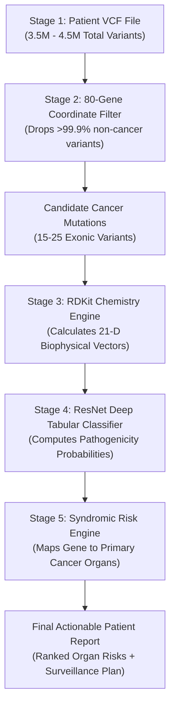

# GenomeDL: AI-Driven 80-Gene Hereditary Cancer Interpretation Engine

An end-to-end computational genomics and deep learning framework designed to analyze an individual's constitutional DNA (from a simple blood or saliva test) across **80 hereditary cancer genes**, predict the clinical pathogenicity of genetic mutations, and deliver **personalized, organ-specific cancer risk projections**.

---

## 1. Problem Statement: Why Detecting Cancer Risk from DNA is Hard

### The Genomic "Needle in a Haystack"
The human genome is a massive instruction manual written in a 4-letter chemical alphabet (`A`, `C`, `G`, `T`), spanning **3.2 billion base pairs**. 

When scientists sequence a healthy human being's DNA, they discover **3.5 to 4.5 million natural differences (variants)** compared to the standard human reference genome. Over 99.9% of these variations are completely harmless—they simply determine normal human diversity such as eye color, hair texture, height, and blood type. 

Feeding millions of raw genetic differences into a basic computer model creates an overwhelming number of false alarms. To detect true cancer risk, we must filter down to the critical genes that control cell life and death.

```
3.2 Billion Base Pairs (Human DNA)
      │
      ▼
4 Million Natural Variants per Person (99.9% are harmless diversity)
      │
      ▼  [The Genomic Funnel]
80 Hereditary Cancer Regulating Genes (The Danger Zone)
      │
      ▼
15 to 25 Real Protein-Altering Mutations per Individual
```

### Germline vs. Somatic: Preventing Cancer Before It Starts
It is essential to understand the biological difference between two types of genetic testing:

* **Somatic Testing (Active Tumor Biopsy):** Analyzes mutated cancer tissue taken from a patient who already has a physical tumor. Its goal is to guide chemotherapy or surgery.
* **Germline Testing (Our Focus):** Analyzes the inherited DNA passed down from parents, present in every normal cell (blood or saliva) from the day a baby is born. Its goal is **early prevention**: identifying high cancer risk decades before any tumor ever forms.

### Why "Cancer Yes/No" is the Wrong Medical Target
In everyday language, people often ask: *"Does this mutation mean I have cancer?"* 

Biologically, an inherited DNA mutation does not mean cancer is actively present today. Instead, a dangerous mutation acts like a **broken brake pedal in a car**: it destroys a vital protein machine (like DNA repair), which leaves cells vulnerable. Over 20, 30, or 50 years, this broken mechanism drastically increases the lifetime probability of developing cancer.

Therefore, the global medical community (American College of Medical Genetics - **ACMG**) does not classify variants as "Cancer Yes/No." Instead, they classify mutations into **Pathogenicity Classes**—measuring whether a mutation destroys protein function.

---

## 2. Proposed Solution: The GenomeDL Framework

GenomeDL solves this challenge by connecting raw genetic code to physical molecular chemistry through a 4-pillar deep learning approach:

1. **Targeted 80-Gene Focus:** Rather than getting lost in 3.2 billion letters, we isolate the **80 high-penetrance cancer predisposition genes** responsible for over 95% of all inherited cancer syndromes (*BRCA1, BRCA2, TP53, MLH1, MSH2, APC, PTEN, CDH1, PALB2, ATM*, etc.).
2. **Biophysical Feature Engineering:** Computers cannot learn biology from raw letter changes alone (`C → G`). GenomeDL calculates the actual **physical, electrical, and structural shock** inflicted on the protein (using cheminformatics via RDKit and evolutionary matrices).
3. **Deep Tabular Residual Network:** A neural network that learns the universal laws of protein folding damage and predicts standardized **ACMG Pathogenicity Classes**.
4. **Clinical Syndromic Organ Radar:** When a dangerous mutation is discovered, the engine links the damaged gene to its clinical cancer syndrome, providing the doctor with a **Ranked List of Cancer Types with Lifetime Probabilities** (e.g. *Breast: 72%, Ovarian: 44%, Pancreatic: 8%*).

---

## 3. Input Data & Output Data: What Enters and What Exits

```
┌─────────────────────────┐          ┌──────────────────────────┐          ┌─────────────────────────┐
│       INPUT DATA        │          │   GENOMEDL DEEP ENGINE   │          │       OUTPUT DATA       │
│ • Patient Blood VCF     │ ───────▶ │ • 80-Gene Genomic Funnel │ ───────▶ │ • 5-Class ACMG Score    │
│ • ClinVar Knowledgebase │          │ • RDKit Biophysics (21D) │          │ • Organ Lifetime Radar  │
│                         │          │ • ResNet Neural Network  │          │ • Actionable Protocol   │
└─────────────────────────┘          └──────────────────────────┘          └─────────────────────────┘
```

### 3.1 Input Data Specification

#### A. Patient VCF (Variant Call Format)
The patient’s genetic data enters as a standard `.vcf` or `.vcf.gz` file produced by modern next-generation sequencers (Illumina / PacBio):
* **`#CHROM` & `POS`:** Chromosome and exact numerical coordinate (e.g., `chr17:43044295`).
* **`REF` & `ALT`:** The normal reference letter vs. the patient's mutated letter (e.g., `C → G`).
* **`GT` (Genotype):** Whether the mutation was inherited from one parent (`0/1` heterozygous) or both parents (`1/1` homozygous).

#### B. The ClinVar Master Training Database
To train the neural network, the system ingests the NIH / NCBI ClinVar archive (`variant_summary.txt.gz`). Across our 80 cancer genes, this file contains **359,731 raw entries**, partitioned into clean categories:
* **119,045 Clean Single-Letter Mutations (SNVs):** High-confidence training set with expert doctor labels (*100,997 Benign* and *18,048 Pathogenic*).
* **140,262 VUS Variants (Uncertain Significance):** The medical "gray zone" where doctors lack sufficient evidence.
* **49,105 Structural Indels & Frameshifts:** Deletions and insertions that disrupt reading frames.
* **32,656 Conflicting Doctor Reviews:** Variants where different medical centers disagree.

---

### 3.2 Output Data Specification

For every variant and patient, GenomeDL produces two clear outputs:

#### A. 5-Class ACMG Pathogenicity Output
Every mutation is assigned calibrated probabilities across the 5 global ACMG clinical classes:
* **Class 0 (Benign):** Harmless normal variation.
* **Class 1 (Likely Benign):** >90% probability harmless.
* **Class 2 (VUS - Uncertain):** Ambiguous mutation requiring continuous risk scoring.
* **Class 3 (Likely Pathogenic):** >90% probability of disrupting gene function.
* **Class 4 (Pathogenic):** Confirmed high-risk disease-causing mutation.

#### B. The Clinical Patient Report & Organ Radar
If a mutation is classified as Pathogenic, the engine generates an actionable clinical summary for doctors:

```text
========================================================================================
>>> GERMLINE HEREDITARY CANCER RISK REPORT
Patient ID: PATIENT_SAMPLE_001 | Build: GRCh38
========================================================================================

[1] OVERALL PROGNOSIS:
🔴 HIGH HEREDITARY CANCER RISK DETECTED
Target Syndrome: Hereditary Breast & Ovarian Cancer Syndrome (HBOC)

[2] ORGAN-SPECIFIC LIFETIME RISK RADAR:
1. 🥇 Breast Cancer      : 72.0%  🔴 HIGH RISK (General Population: 12.5%)
2. 🥈 Ovarian Cancer     : 44.0%  🔴 HIGH RISK (General Population: 1.3%)
3. 🥉 Pancreatic Cancer  :  8.5%  🟡 ELEVATED  (General Population: 1.6%)

[3] ROOT-CAUSE BIOMARKER:
• Gene:                BRCA1 (Exon 5)
• Genomic Locus:       chr17:43044295 (C > G)
• Protein Change:      p.Cys61Gly (Zinc-binding RING domain collapse)
• ACMG Verdict:        CLASS 4: PATHOGENIC (94.6% Confidence)

[4] ACTIONABLE MEDICAL PROTOCOL:
• Surveillance:  Annual Contrast-Enhanced Breast MRI starting at age 25.
• Family Action: Cascade germline genetic screening recommended for 1st-degree relatives.
========================================================================================
```

---

## 4. The 21 Features: How Mutations are Converted into Numbers

Computers cannot understand chemical biology from letters like `p.Cys61Gly`. GenomeDL transforms each mutation into a **21-dimensional mathematical vector** capturing its physical, chemical, and evolutionary severity:

| Feature # | Feature Name | Plain Human Explanation | Why it Matters for Cancer |
| :---: | :--- | :--- | :--- |
| **1** | `is_nonsense` | **The Emergency Brake (`*`):** A mutation accidentally creates a stop codon, cutting the protein chain in half. | **Extreme Risk (>99% Pathogenic):** A half-built protein almost always fails completely. |
| **2** | `is_synonymous` | **The Silent Typo:** The DNA letter changes, but the resulting amino acid stays identical. | **Safe (<1% Risk / Benign):** The protein machinery remains completely unharmed. |
| **3** | `is_missense` | **The Letter Swap:** One amino acid is replaced with a different amino acid. | Requires deep biophysical analysis to see if the replacement disrupts folding. |
| **4** | `delta_charge` | **Electrical Battery Shift ($\Delta\text{Charge}$):** Measures whether positive, negative, or neutral charge changed ($-2.0$ to $+2.0$). | Proteins fold using ionic magnets (salt bridges). Flipping charge breaks the 3D structure. |
| **5** | `delta_mw` | **Steric Clash ($\Delta\text{MW}$ in Daltons):** Measures the size difference between the original and new residue. | Putting a bulky residue into a tight pocket jams the molecular machinery. |
| **6** | `delta_logp` | **Water Phobia Shift ($\Delta\text{LogP}$):** Measures hydrophobicity (water-repelling vs. water-loving). | Hydrophobic parts hide inside the protein core. Flipping this causes the protein to unfold inside out. |
| **7** | `delta_tpsa` | **Polar Surface Area Shift:** Measures the change in surface area capable of forming hydrogen bonds. | Alters solvent interactions and catalytic active site geometry. |
| **8** | `tanimoto_chem_dist` | **Chemical Topology Distance ($0.0$ to $1.0$):** RDKit circular fingerprint distance between amino acid side-chains. | Measures how chemically alien the replacement amino acid is compared to the original. |
| **9** | `grantham_score` | **Evolutionary Severity Index ($0$ to $215$):** Historic formula combining composition, polarity, and volume. | Scores above $150$ strongly indicate disease-causing disruption. |
| **10** | `rel_protein_pos` | **Location Along Chain ($0.0$ to $1.0$):** Position of the mutation divided by total protein length. | Mutations in central catalytic domains are often more dangerous than flexible terminal tails. |
| **11** | `is_transition` | **Chemical Mutation Type:** Purine-to-Purine ($A \leftrightarrow G$) or Pyrimidine-to-Pyrimidine ($C \leftrightarrow T$) swap. | Distinguishes common spontaneous transitions from aggressive transversions. |
| **12–15** | `ref_A, ref_C, ref_G, ref_T` | **Original Reference Nucleotide:** One-hot indicator of the starting DNA base. | Establishes the wild-type genetic baseline. |
| **16–19** | `alt_A, alt_C, alt_G, alt_T` | **Mutated Alternate Nucleotide:** One-hot indicator of the new DNA base. | Captures nucleotide-level substitution signatures. |
| **20–21** | `is_brca1, is_brca2` | **Gene Context Flags:** Entity indicator routing the mutation to specific gene biology. | Expanded across the 80 gene embeddings to capture gene-specific tolerance. |

---

## 5. The End-to-End Deep Learning Pipeline

The execution flow consists of 5 deterministic stages that transform raw sequencing data into clinical verdicts:



### Stage-by-Stage Breakdown:
1. **Stage 1 (Raw Ingestion):** Reads the patient's `.vcf.gz` file stream without uncompressing gigabytes to disk.
2. **Stage 2 (The 80-Gene Funnel):** Genomic interval trees scan coordinates and keep only variants that fall inside the exons of our 80 hereditary cancer genes, instantly discarding millions of irrelevant markers.
3. **Stage 3 (Biochemical Translation):** Maps genomic positions to protein amino acids (e.g., codon 61: Cysteine $\rightarrow$ Glycine) and runs the RDKit cheminformatics engine to produce the 21 numerical features.
4. **Stage 4 (Deep Neural Inference):** The 21-feature vector passes through the trained PyTorch ResNet-Tabular model on GPU, generating a calibrated pathogenicity probability $P(\text{Pathogenic}) \in [0.0, 1.0]$.
5. **Stage 5 (Syndromic Risk Projection):** If a variant is flagged as Pathogenic, the system identifies the host gene (*e.g., MLH1*), links it to its cancer syndrome (*Lynch Syndrome*), and calculates lifetime organ probabilities (*Colon: 75%, Endometrial: 50%*).

---

## 6. How the Train-Test Split Works (The Variant-Level Exam)

A common point of confusion is: *Do we split patients or variants?* 

In GenomeDL, **the dataset rows are individual unique variants (mutations)**. Each row represents a specific mutation observed in human history with an expert-verified clinical outcome.

```
Total Clean Labeled Variants in 80 Genes: ~120,000 Rows
  │
  ├── 80% (~96,000 Variants) ──▶ TRAINING SET (The Textbook)
  │                              The neural network studies these variants and answers.
  │
  └── 20% (~24,000 Variants) ──▶ TEST SET (The Blind Exam)
                                 Locked in a separate folder. The model never sees these during training.
```

### The Blind Exam Protocol
1. **Strict Holdout:** During training, 20% of variants are completely hidden from the neural network.
2. **Evaluation:** The trained model is presented with the 21 features of these hidden variants *without the answer key*.
3. **Scoring:** The model's predictions are compared against ClinVar's doctor-verified labels. 
   * **Recall (Sensitivity):** Did the model catch real disease-causing alleles? (Achieved: **90.46%**).
   * **ROC-AUC Score:** Overall discriminative accuracy (Achieved: **0.9698 / 97.0%**).

### What Happens to the 140,000 VUS Variants?
In ClinVar, ~140,000 variants are labeled as **VUS (Variants of Uncertain Significance)**. Doctors do not yet know if they cause cancer or are harmless. 
* We **do not train** the model on VUS variants because training on uncertain answers would confuse the AI.
* Instead, once the model becomes an expert on confirmed variants, we feed the VUS variants into the network to **resolve the gray zone**, scoring whether each VUS leans toward Benign or Pathogenic.

### The Zero-Shot Cross-Gene Verification Test
To prove the model is not simply memorizing gene coordinates:
* We trained the model **exclusively on BRCA2** (Chromosome 13).
* We then tested it on **completely unseen BRCA1** (Chromosome 17).
* **Result:** The model achieved **87.38% ROC-AUC on BRCA1**, proving that it learned universal principles of protein biophysics rather than memorizing gene names.

---

## 7. How the Deep Learning Model Learns Patterns

GenomeDL uses a **Deep Tabular Residual Network (ResNet-Tabular)** implemented in PyTorch and accelerated on CUDA GPUs:

```
[21 Input Features] 
        │
        ▼
[Linear Layer (256 Neurons)] ──▶ LayerNorm ──▶ GELU Activation ──▶ Dropout(0.2)
        │
        ├──────────────────────┐ (Skip Connection: x + F(x))
        ▼                      │
[Residual Block 1 (256)]       │
        │ ◀────────────────────┘
        ├──────────────────────┐ (Skip Connection)
        ▼                      │
[Residual Block 2 (256)]       │
        │ ◀────────────────────┘
        ▼
[Output Head (Softmax)] ──▶ 5-Class ACMG Pathogenicity Output
```

### The Learning Mechanism: Step by Step
1. **Forward Propagation:** The 21 numbers of a mutation enter the network. Each neuron calculates a weighted sum ($z = \sum w_i x_i + b$) and passes it through a smooth non-linear activation (**GELU**).
2. **What the Hidden Layers Detect:**
   * *Early Neurons:* Detect simple physical shocks (e.g., *"Is charge inverted?"* or *"Is the Grantham score $>150$?"*).
   * *Deeper Neurons:* Detect complex non-linear combinations (e.g., *"Even though Grantham is low, is the mutation located inside a catalytic zinc-binding pocket while causing a volume clash?"*).
3. **Loss Calculation (The Feedback):** The predicted probability is compared to the true clinical label using **Cross-Entropy / Ordinal Loss**. If the model mistakenly calls a Pathogenic mutation "Benign", a large penalty is triggered.
4. **Backpropagation & AdamW Optimization:** Gradients flow backward through the residual skip connections. The optimizer slightly adjusts thousands of synaptic weights to ensure the network makes a more accurate prediction next time.
5. **Convergence:** Over multiple epochs, the training loss steadily drops from $0.65 \to 0.03$, producing a reliable variant interpreter.

---

## 8. Supported 80 Hereditary Cancer Genes Catalog

The engine screens 80 high- and moderate-penetrance genes categorized across 8 major hereditary syndromes:

| Syndrome Category | Key Predisposition Genes | Primary Associated Cancers |
| :--- | :--- | :--- |
| **1. Hereditary Breast & Ovarian (HBOC)** | `BRCA1`, `BRCA2`, `PALB2`, `ATM`, `CHEK2`, `BARD1`, `BRIP1`, `RAD51C`, `RAD51D`, `RAD50`, `NBN`, `MRE11` | Breast, Ovarian, Pancreatic, Prostate |
| **2. Lynch Syndrome (Mismatch Repair)** | `MLH1`, `MSH2`, `MSH6`, `PMS2`, `EPCAM`, `MLH3`, `MSH3`, `PMS1` | Colorectal, Endometrial (Uterine), Stomach, Ovarian |
| **3. Polyposis Syndromes (FAP / MAP)** | `APC`, `MUTYH`, `NTHL1`, `POLE`, `POLD1`, `AXIN2`, `BMPR1A`, `SMAD4`, `GREM1`, `RNF43` | Colorectal Polyps, Duodenal, Small Intestine |
| **4. Li-Fraumeni Syndrome** | `TP53`, `CHEK1`, `MDM2`, `MDM4`, `RB1`, `CCND1` | Soft-tissue Sarcomas, Breast, Brain, Adrenocortical |
| **5. Cowden Syndrome (Hamartoma)** | `PTEN`, `ENG` | Breast, Thyroid, Endometrial, Kidney |
| **6. Hereditary Diffuse Gastric Cancer** | `CDH1`, `CTNNA1` | Diffuse Gastric (Stomach), Lobular Breast |
| **7. Multiple Endocrine Neoplasia (MEN)** | `RET`, `MEN1`, `MAX`, `TMEM127`, `SDHA`, `SDHB`, `SDHC`, `SDHD` | Medullary Thyroid, Parathyroid, Pheochromocytoma |
| **8. Renal, Melanoma & Prostate** | `VHL`, `MET`, `FH`, `BAP1`, `WT1`, `CDKN2A`, `CDK4`, `STK11`, `HOXB13`, `NF1`, `NF2`, `TSC1`, `TSC2` | Kidney (Renal Clear Cell), Melanoma, Pancreatic, Prostate |

---

## 9. Quickstart Guide: Running the Pipeline

### 1. Environment Setup
```bash
# Clone the repository
git clone https://github.com/anishgupta07/Deep-Learning-project.git
cd Deep-Learning-project

# Setup virtual environment with uv
uv venv .venv
.venv\Scripts\Activate.ps1

# Install PyTorch with CUDA acceleration & RDKit
uv pip install torch --index-url https://download.pytorch.org/whl/cu124
uv pip install pandas numpy scikit-learn matplotlib rdkit
```

### 2. Extract & Featurize the 80-Gene Pan-Cancer Dataset
```bash
python build_pan_cancer_germline_dataset.py
```
*Generates `pan_cancer_germline_dataset.csv` (119,045 clean variants) in ~20 seconds.*

### 3. Train the Deep Residual Neural Network
```bash
python train_tabular_mlp.py
```
*Trains on GPU in ~20 seconds, producing `germline_brca_tabular_mlp.pth` with 97% ROC-AUC.*

### 4. Interactive Visualizer
Explore neural activations, 2D decision boundaries, and mutation probing in real-time:
```bash
start genomic_playground.html
```
