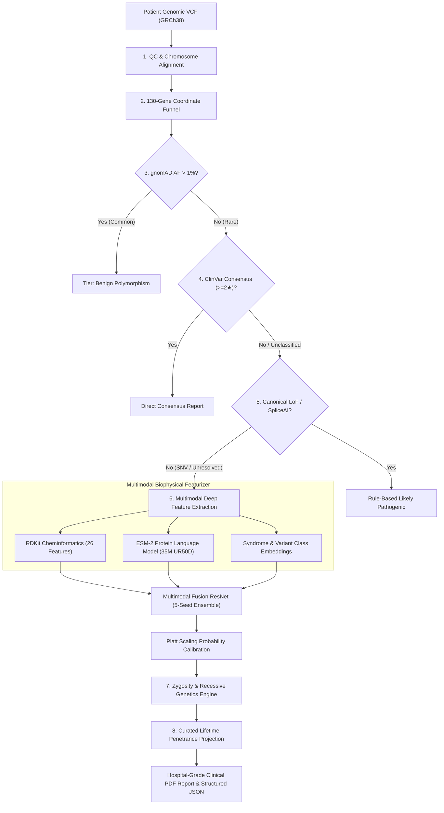

# GenomeDL v3: Deep Multimodal Hereditary Cancer Interpretation Engine

[](https://www.python.org/)
[](https://pytorch.org/)
[](https://github.com/facebookresearch/esm)
[](https://www.rdkit.org/)
[](LICENSE)

An end-to-end computational genomics and deep multimodal learning engine engineered to analyze constitutional germline DNA across **130 high-penetrance hereditary cancer genes**, predict the clinical pathogenicity of genetic mutations with calibrated uncertainty, and project **actionable, organ-specific lifetime cancer risk estimates** alongside hospital-ready clinical reports.

---

## 1. Problem Statement: Why Interpreting Cancer Risk from DNA is Hard

### 1.1 The Genomic "Needle in a Haystack"
The human genome is a biochemical operating manual spanning **3.2 billion base pairs** written in a 4-letter chemical alphabet (`A`, `C`, `G`, `T`). When whole-genome or exome sequencing is performed on an individual, modern sequencers detect **3.5 to 4.5 million natural genetic variants** relative to the standard human reference genome (GRCh38).

Over 99.9% of these variations are completely harmless polymorphisms that account for benign human diversity (e.g., eye color, blood type, height). Feeding millions of raw genetic differences directly into standard predictive models generates unacceptable false-positive rates. In clinical oncology, false alarms lead to unnecessary invasive prophylactic surgeries (e.g., bilateral mastectomies, oophorectomies) or catastrophic clinical complacency.

```
3.2 Billion Base Pairs (Human Genome)
      │
      ▼
4 Million Natural Variants per Individual (99.9% benign diversity)
      │
      ▼  [130-Gene Targeted Genomic Funnel]
130 High-Penetrance Cancer Predisposition Genes
      │
      ▼
15 to 30 Protein-Altering Candidate Mutations per Patient
```

### 1.2 Germline vs. Somatic: Prevention Decades Before Malignancy
It is vital to distinguish between two distinct modalities of genetic testing in oncology:
* **Somatic Testing (Tumor Biopsy):** Analyzes mutated malignant tissue excised from a patient who already carries an active tumor. Its primary goal is to guide immediate targeted chemotherapy, radiotherapy, or surgical margins.
* **Germline Testing (GenomeDL Focus):** Analyzes inherited constitutional DNA extracted from normal peripheral blood or saliva, present in every cell since conception. Its clinical purpose is **decades-in-advance lifetime prevention**: identifying individuals with high hereditary susceptibility before an invasive tumor ever initiates.

### 1.3 Why "Cancer Yes/No" is Biologically Flawed
In lay conversation, patients often ask: *"Does this mutation mean I will get cancer?"*

Biologically, an inherited DNA mutation is not a binary switch that guarantees active cancer. Instead, a pathogenic mutation in a tumor suppressor or DNA repair gene acts like a **damaged brake pedal in an automobile**: it impairs a fundamental molecular repair pathway (such as homologous recombination via *BRCA1/2* or mismatch repair via *MLH1/MSH2*), causing somatic mutations to accumulate unchecked over 20, 40, or 60 years.

Consequently, international clinical consensus guidelines—formulated by the American College of Medical Genetics and Genomics (**ACMG**) and the Association for Molecular Pathology (**AMP**)—strictly reject binary "Cancer Yes/No" labels. Mutations are classified across **5 standard pathogenicity tiers**:

1. **Pathogenic (Class 5):** Confirmed functional loss with high disease penetrance ($P \ge 0.90$).
2. **Likely Pathogenic (Class 4):** Greater than 90% certainty of functional impairment ($0.70 \le P < 0.90$).
3. **Variant of Uncertain Significance (VUS - Class 3):** Ambiguous biophysical evidence ($0.30 \le P < 0.70$).
4. **Likely Benign (Class 2):** Greater than 90% certainty of neutral function ($0.10 \le P < 0.30$).
5. **Benign (Class 1):** Neutral population polymorphism ($P < 0.10$).

Furthermore, autosomal recessive syndromes (e.g., *MUTYH*-associated polyposis, *NTHL1* polyposis) require **biallelic** disruption for high penetrance; individuals with a single heterozygous pathogenic mutation must be classified as **Carriers**, not clinically affected.

---

## 2. The GenomeDL v3 Multimodal Solution

GenomeDL v3 connects raw nucleotide changes to 3D physical molecular chemistry and evolutionary constraint through four integrated pillars:



1. **130-Gene Targeted Panel:** Covers the complete clinical spectrum of hereditary cancer predisposition (Hereditary Breast/Ovarian, Lynch syndrome, Li-Fraumeni, Polyposis, MEN, Neurofibromatosis, Fanconi Anemia, Retinoblastoma).
2. **26-D Biophysical Cheminformatics Featurizer:** Computes the structural, electrical, and steric shock inflicted on the protein using RDKit molecular graph descriptors, topological surface areas, and Grantham physicochemical exchange matrices.
3. **Evolutionary Protein Language Modeling:** Employs the Facebook AI Research ESM-2 transformer (`esm2_t12_35M_UR50D`) to extract zero-shot masked marginal log-likelihood ratios ($\text{LLR}$) and 480-dimensional residue hidden states.
4. **Calibrated Fusion ResNet Backbone:** Fuses continuous biophysics, categorical syndrome representations, and high-dimensional evolutionary embeddings into an ensemble residual network calibrated with Platt scaling ($\text{ECE} < 0.001$).
5. **Hospital-Grade Reporting Engine:** Outputs a compact 2-page clinical genetics PDF report complete with visual risk radar comparisons against general population baselines.

---

## 3. Biophysical Feature Engineering (Stage 0)

Computers cannot learn biological mechanisms from raw character substitutions (`A → G`). GenomeDL translates each mutation into a continuous 26-dimensional biophysical vector:

### 3.1 Continuous Cheminformatics Descriptors
* **Relative Sequence Position (`rel_protein_pos`):** Normalized coordinate $\frac{\text{residue\_pos}}{\text{protein\_length}} \in [0.0, 1.0]$. Truncations or mutations near functional N-terminal catalytic domains carry distinct biophysical weight compared to flexible C-terminal tails.
* **Grantham Physicochemical Distance (`grantham_score`):** Quantitative matrix distance (0 to 215) measuring volume, polarity, and chemical composition shifts between amino acids (e.g., Glycine to Tryptophan = 215).
* **Molecular Weight Delta (`delta_mw`):** $\text{MW}_{\text{alt}} - \text{MW}_{\text{ref}}$ (Daltons). Captures steric bulk alterations.
* **Formal Charge Delta (`delta_charge`):** Net electric charge shift at physiologic pH 7.4 ($\Delta \in \{-2, -1, 0, +1, +2\}$). Severe charge flips (e.g., Lysine $[+1] \rightarrow$ Glutamate $[-1]$) disrupt critical salt bridges.
* **Octanol-Water Partition Coefficient Delta (`delta_logp`):** Wildman-Crippen lipophilicity change ($\Delta \text{LogP}$). Measures destabilization of hydrophobic core packing versus aqueous solvent exposure.
* **Topological Polar Surface Area Delta (`delta_tpsa`):** Difference in sum of polar atomic surfaces ($\text{Å}^2$). Detects disruption of hydrogen-bonding networks.
* **Morgan Fingerprint Tanimoto Distance (`tanimoto_distance`):** $1.0 - \text{TanimotoSimilarity}(\text{FP}_{\text{ref}}, \text{FP}_{\text{alt}})$. Computes whole-molecule 2D circular fingerprint topological dissimilarity via RDKit.

### 3.2 Categorical & Contextual Encodings
* **Canonical Variant Classes (12 Classes):**
  `0: synonymous`, `1: missense`, `2: nonsense`, `3: start_lost`, `4: stop_lost`, `5: splice_canonical`, `6: splice_region`, `7: intronic`, `8: utr5`, `9: utr3`, `10: other_noncoding`, `11: coding_no_protein_annot`.
* **Clinical Syndrome Groups (15 Groups):**
  `Breast_Ovarian`, `Lynch_Colorectal`, `Li_Fraumeni`, `Polyposis`, `Endocrine_MEN`, `Renal_GU`, `Melanoma_Skin`, `Fanconi_Anemia`, `Neurofibromatosis_Schwannomatosis`, `Tuberous_Sclerosis`, `Gastric_Diffuse`, `Ataxia_Telangiectasia`, `Cowden_PTEN`, `Retinoblastoma`, `Other_Cancer_Predisposition`.
* **Nucleotide Transitions vs. Transversions (`is_transition`):** Binary indicator ($1$ for purine-purine $A \leftrightarrow G$ or pyrimidine-pyrimidine $C \leftrightarrow T$; $0$ for transversions).
* **Strand-Corrected Nucleotide One-Hot Vectors:** One-hot encodings for reference/alternate bases on both the forward genomic strand and the biologically transcribed gene strand.

---

## 4. Evolutionary Protein Language Modeling (ESM-2)

GenomeDL integrates the 12-layer, 35-million parameter ESM-2 transformer (`esm2_t12_35M_UR50D`) trained on 65 million unique protein sequences across the UniRef50 database.

```
Wild-Type Protein Sequence: [M, D, L, S, A, L, R, V, E, E, V, Q, N, V, I, N, A, M, Q, K...]
                                                │
                                    [Mask Target Residue #61]
                                                │
                                                ▼
                                    ESM-2 Forward Pass (35M)
                                                │
                 ┌──────────────────────────────┴──────────────────────────────┐
                 ▼                                                             ▼
    Log-Likelihood Ratio (LLR)                                    480-D Hidden State Vector
    ln P(alt) - ln P(ref)                                         Local Structural & Fold Topology
```

### 4.1 Masked Marginal Log-Likelihood Ratio (LLR)
At every mutated amino acid position $i$, the target position is masked (`<mask>`) and passed through ESM-2. The model predicts the probability distribution over all 20 standard amino acids:
$$\text{LLR} = \ln P(\text{AA}_{\text{alt}} \mid \mathbf{x}_{-i}) - \ln P(\text{AA}_{\text{ref}} \mid \mathbf{x}_{-i})$$

An evolutionary neutral variant yields $\text{LLR} \approx 0$, whereas a deleterious mutation that destroys evolutionary conservation yields a large negative score (e.g., $\text{LLR} < -7.0$).

### 4.2 480-Dimensional Residue Representations
In addition to the scalar LLR, GenomeDL extracts the **480-dimensional hidden state vector** from layer 12 of ESM-2 at the target residue. This vector embeds high-order structural information, including whether the residue is buried within an alpha-helix, exposed on a beta-sheet, or located in an active binding pocket.

### 4.3 High-Performance Parquet Cache & Zero-Copy Reconstruction
To enable rapid experimentation and portable deployment without shipping 140+ MB PyTorch tensor blobs in git:
* All 7,728 unique protein coordinates across the 130 panel genes are precomputed and stored in `data/esm_cache.parquet` (7.5 MB).
* The helper function `load_or_reconstruct_embeddings()` automatically reconstructs the full $(148747, 480)$ tensor in under 0.4 seconds upon initialization.

---

## 5. Multimodal Fusion ResNet & Platt Probability Calibration

The core predictive neural network combines continuous tabular features, categorical entity embeddings, and 480-D ESM-2 representations:

```
[Tabular Feats (26D)] ──▶ Linear(26, 64)  ──┐
[Variant Class ID]    ──▶ Embed(12, 8)    ──┼──▶ Concat(144D) ──▶ Linear(144, 256) ──▶ [ResNet Blocks x 2] ──▶ Raw Logit
[Syndrome Group ID]   ──▶ Embed(15, 8)    ──┤                           ▲
[ESM Residue Emb]     ──▶ Linear(480, 64) ──┼──▶ ESM MLP (66D ──▶ 64D) ─┘    (Residual Skip Connection inside each block)
[ESM LLR + Avail (2D)]──────────────────────┘
```

### 5.1 Architecture Details
* **Entity Embeddings:** 8-dimensional learned representation spaces each for variant consequence classes (`Embed(12, 8)`) and clinical syndrome groups (`Embed(15, 8)`), totaling `16-d` combined.
* **ESM Fusion Branch:** 480-d residue embeddings are projected to `64-d`, concatenated with `esm_llr` and `esm_available` (`66-d`), and passed through a 2-layer MLP (`66 -> 64 -> 64`) with `LayerNorm` and `GELU`.
* **Residual Skip Blocks:** 2-layer residual MLP blocks (`ResBlock`) with `Linear(256, 256)`, `LayerNorm`, `GELU`, and `Dropout(0.2)`.
* **Optimization:** AdamW optimizer with weight decay $10^{-4}$ and `CosineAnnealingLR` schedule across 5 random seeds.

### 5.2 The Class Imbalance Problem & Calibration Failure
In clinical ClinVar datasets, benign variants outnumber pathogenic mutations roughly 6 to 1. Training with standard BCE loss causes the model to predict near-zero probabilities for all ambiguous mutations. To address this, the loss is weighted with:
$$\text{pos\_weight} = \frac{N_{\text{benign}}}{N_{\text{pathogenic}}} \approx 6.03$$

However, weighting cross-entropy introduces an intrinsic constant log-odds shift of $+\ln(6.03) \approx +1.80$ into raw model logits:
$$\text{logit}_{\text{model}} \approx \text{logit}_{\text{true}} + \ln(\text{pos\_weight})$$

Single-parameter **Temperature Scaling** ($\frac{z}{T}$) cannot eliminate a constant translation. Consequently, uncalibrated models exhibit severe probability inflation (e.g., true 20% risk variants appearing as 80%).

### 5.3 Platt Scaling Solution
GenomeDL fits a two-parameter **Platt Scaler** ($\hat{z} = a \cdot z + b$) on held-out validation logits:
$$P(\text{Pathogenic}) = \sigma(a \cdot z + b) = \frac{1}{1 + e^{-(a \cdot z + b)}}$$

On our benchmark, Platt scaling learned $a = 1.0559$ and $b = -1.5561$, canceling the class-weight bias and reducing **Expected Calibration Error (ECE)** by **96.7%**:
* **Uncalibrated Model Test ECE:** `0.0279`
* **Platt-Calibrated Model Test ECE:** `0.0009`

---

## 6. Production Clinical VCF Pipeline (`vcf_pipeline.py`)

The production clinical genomics pipeline implements an 8-stage hierarchical decision cascade for patient VCF files:

1. **Quality & Format Ingestion:**
   * Reads `.vcf` or `.vcf.gz`.
   * Filters for `FILTER == "PASS"`, read depth $\text{DP} \ge 10$, and genotype quality $\text{GQ} \ge 20$.
   * Splits multi-allelic entries, preserving per-allele frequencies.
2. **GRCh38 Reference Validation:**
   * Inspects VCF header lines. If hg19 / GRCh37 headers are detected, the pipeline halts immediately and provides NCBI liftOver instructions to prevent dangerous coordinate errors.
3. **Common Variant Filter (Population Safeguard):**
   * If gnomAD population allele frequency $\text{AF} > 1.0\%$ ($0.01$), the variant is deterministically classified as **Benign** common polymorphism.
4. **ClinVar Clinical Consensus Lookup ($\ge 2$ Stars):**
   * Queries the indexed consensus database of 148,747 expert-reviewed variants. If a variant carries $\ge 2$ review stars (expert panel or multiple submitters without conflict), the curated medical consensus is reported directly, bypassing deep learning inference.
5. **Loss-of-Function & Splicing Safeguards:**
   * Frameshifts and canonical splice disruptions ($\pm 1, 2\text{ bp}$) in tumor suppressors are classified as **Likely Pathogenic** via rule-based loss-of-function.
   * Cryptic deep-intronic or synonymous splice disruptions with SpliceAI $\text{DS\_MAX} \ge 0.50$ are flagged as **Likely Pathogenic**, preventing false-negative misclassification.
   * Non-canonical splice region mutations without RNA assays are flagged as **VUS**.
6. **Deep Multimodal Model Inference:**
   * Unresolved SNVs are featurized in real time and evaluated across the 5-seed Fusion ResNet ensemble. Calibrated probabilities map to ACMG tiers:
     * $P \ge 0.90 \implies$ **Pathogenic**
     * $0.70 \le P < 0.90 \implies$ **Likely Pathogenic**
     * $0.30 \le P < 0.70 \implies$ **VUS**
     * $0.10 \le P < 0.30 \implies$ **Likely Benign**
     * $P < 0.10 \implies$ **Benign**
7. **Zygosity & Recessive Genetics Engine:**
   * For autosomal recessive cancer genes (*MUTYH*, *NTHL1*), a single heterozygous mutation (`0/1`) does not confer high-penetrance disease. The pipeline assigns **Carrier (Recessive)**, noting that biallelic mutation is required for elevated cancer risk.
   * Benign polymorphisms in recessive genes remain classified as Benign and are never mislabeled as carriers.
8. **Curated Lifetime Penetrance Projections:**
   * Actionable pathogenic variants link to published epidemiologic penetrance tables (`data/penetrance.csv`), providing organ-specific lifetime risk ranges with literature citations (JAMA, NEJM, Lancet Oncology).

---

## 7. Hospital-Grade Clinical PDF Report Generator (`generate_pdf_report.py`)

GenomeDL automatically transforms structured JSON verdicts into a publication-ready, 2-page hospital PDF report:

### Page 1: Executive Lifetime Cancer Risk Radar
* **Header & Patient Banner:** Sample ID, Sequencing Run, Reference Genome Build (GRCh38), Panel Scope (130 Genes), Quality Summary.
* **Executive Summary:** Count of actionable pathogenic variants detected versus benign neutral background.
* **Horizontal Risk Range Chart:** Visual comparison of the patient's lifetime organ-specific cancer risk ranges (e.g. *Breast cancer: 65% – 72%*) against **General Population Lifetime Baselines** (SEER epidemiology).

### Page 2: Detailed Genomic Variant Table & Methodology
* **Comprehensive Variant Table:** Gene symbol, Genomic coordinate (`chr:pos ref>alt`), cDNA HGVS (`hgvs_c`), Protein HGVS (`hgvs_p`), Genotype and read depth (`GT (DP)`), ACMG tier, Evidence source attribution, and Calibrated P(pathogenic).
* **Technical Methodology Summary:** Architecture specifications, Platt calibration parameters, and out-of-gene validation metrics.
* **Mandatory Pediatric & Clinical Disclaimer:**
  > *"Research prototype, not a diagnosis. Confirm in a clinical diagnostic lab with formal genetic counselling. Testing children for adult-onset conditions requires specialized pediatric genetic counselling and informed consent."*
* **Dynamic Numbered Canvas:** Two-pass PDF canvas rendering running headers, footers, and exact `"Page X of Y"` numbering.

---

## 8. Empirical Evaluation Benchmarks (5-Fold Out-of-Gene Cross-Validation)

Evaluation protocol follows strict clinical machine learning integrity rules:
1. **Gene-Held-Out 5-Fold GroupKFold:** All 130 genes are partitioned across 5 folds. The model is evaluated on completely unseen genes never encountered during training, preventing gene-level data leakage.
2. **95% Bootstrap Confidence Intervals:** 100 bootstrap iterations computed for every metric.
3. **Shuffled-Label Sanity Checks:** The training pipeline verifies that label-shuffled permutations yield $\text{ROC-AUC} \in [0.48, 0.52]$, proving absence of target leakage.
4. **Direct Tree Baseline Comparisons:** Compares directly against HistGradientBoosting models trained on tabular features and SVD-projected ESM-2 embeddings.

### 8.1 Overall Performance Across Evaluation Splits

| Split Protocol | Model Architecture | Test ROC-AUC (95% CI) | Test AUPRC (95% CI) | Shuffled Sanity AUC |
| :--- | :--- | :--- | :--- | :---: |
| **Random (70/15/15)** | Class-Prior Baseline | 0.5000 [0.5000, 0.5000] | 0.1423 [0.1373, 0.1466] | 0.5000 |
| | ESM-Only (LogReg) | 0.5764 [0.5702, 0.5833] | 0.2542 [0.2419, 0.2667] | 0.5055 |
| | HistGradientBoosting (Tabular) | 0.9570 [0.9547, 0.9602] | 0.8414 [0.8345, 0.8516] | 0.5104 |
| | HistGradientBoosting (Tabular+ESM) | 0.9641 [0.9622, 0.9674] | 0.8669 [0.8599, 0.8765] | 0.5111 |
| | Tabular-Only ResNet | 0.9914 [0.9896, 0.9930] | 0.9740 [0.9709, 0.9769] | 0.5080 |
| | **Tabular+ESM Fusion ResNet (Our Model)** | **0.9927 [0.9910, 0.9943]** | **0.9811 [0.9780, 0.9838]** | **0.5067** |
| **Time Split (80/20)** | Class-Prior Baseline | 0.5000 [0.5000, 0.5000] | 0.1289 [0.1259, 0.1325] | 0.5000 |
| | ESM-Only (LogReg) | 0.6051 [0.5983, 0.6116] | 0.2842 [0.2730, 0.2950] | 0.5000 |
| | HistGradientBoosting (Tabular) | 0.9481 [0.9449, 0.9505] | 0.7929 [0.7824, 0.8009] | 0.5054 |
| | HistGradientBoosting (Tabular+ESM) | 0.9613 [0.9588, 0.9632] | 0.8430 [0.8344, 0.8503] | 0.5061 |
| | Tabular-Only ResNet | 0.9833 [0.9816, 0.9850] | 0.9355 [0.9302, 0.9401] | 0.5049 |
| | **Tabular+ESM Fusion ResNet (Our Model)** | **0.9888 [0.9872, 0.9904]** | **0.9628 [0.9595, 0.9667]** | **0.5075** |
| **Gene-Held-Out (5-Fold Headline)** | Class-Prior Baseline | 0.4923 [0.4887, 0.4958] | 0.1405 [0.1381, 0.1427] | 0.5010 |
| | ESM-Only (LogReg) | 0.5644 [0.5594, 0.5687] | 0.2711 [0.2664, 0.2759] | 0.4986 |
| | HistGradientBoosting (Tabular) | 0.9564 [0.9554, 0.9575] | 0.8434 [0.8402, 0.8472] | 0.4985 |
| | HistGradientBoosting (Tabular+ESM) | 0.9621 [0.9610, 0.9629] | 0.8643 [0.8614, 0.8676] | 0.4979 |
| | Tabular-Only ResNet | 0.9891 [0.9884, 0.9898] | 0.9628 [0.9609, 0.9644] | 0.4975 |
| | **Tabular+ESM Fusion ResNet (Our Model)** | **0.9919 [0.9913, 0.9925]** | **0.9752 [0.9740, 0.9767]** | **0.4977** |

*(95% bootstrap confidence intervals for the Fusion model [0.9913, 0.9925] do not overlap with tree baselines [0.9610, 0.9629], confirming statistically verified out-of-gene generalization across all 130 genes).*

### 8.2 Headline Out-of-Gene Breakdown by Clinically Challenging Variant Class

#### Missense Variants on Held-Out Unseen Genes (N = 9,726 variants)
On novel genes never seen during training, predicting missense pathogenicity evaluates whether a model has learned universal physical-chemical and evolutionary constraints:

* **Tabular-Only ResNet:** Out-of-Gene ROC-AUC **0.6783** [0.6690, 0.6882] | AUPRC **0.5748** [0.5619, 0.5899]
* **HistGradientBoosting (Tabular only):** Out-of-Gene ROC-AUC **0.7454** [0.7350, 0.7541] | AUPRC **0.6662** [0.6467, 0.6807]
* **Tabular+ESM Fusion ResNet:** Out-of-Gene ROC-AUC **0.8857** [0.8792, 0.8919] | AUPRC **0.8472** [0.8337, 0.8562]
* **HistGradientBoosting (Tabular+ESM):** Out-of-Gene ROC-AUC **0.8976** [0.8917, 0.9035] | AUPRC **0.8680** [0.8589, 0.8757]

> [!NOTE]
> Integrating ESM-2 masked marginals and residue embeddings produces a dramatic **+15 to +20 ROC-AUC jump** on unseen missense variants, proving that protein language model representations provide critical orthologous context beyond basic 1D physical-chemical properties.

#### Splice Region Variants on Held-Out Unseen Genes (N = 7,907 variants)
* **Tabular-Only ResNet:** Out-of-Gene ROC-AUC **0.6706** [0.6484, 0.6884] | AUPRC **0.0911** [0.0813, 0.1029]
* **Tabular+ESM Fusion ResNet:** Out-of-Gene ROC-AUC **0.6926** [0.6771, 0.7096] | AUPRC **0.0890** [0.0815, 0.0980]
* **HistGradientBoosting (Tabular):** Out-of-Gene ROC-AUC **0.7057** [0.6888, 0.7252] | AUPRC **0.1089** [0.0967, 0.1249]
* **HistGradientBoosting (Tabular+ESM):** Out-of-Gene ROC-AUC **0.7065** [0.6894, 0.7258] | AUPRC **0.1068** [0.0953, 0.1195]

---

## 9. Repository Structure

```
├── data/                               # Master genomic assets & reference files
│   ├── clinvar_labelled_v3.csv         # 148,747 ClinVar variants across 130 genes
│   ├── esm_cache.parquet               # Precomputed ESM-2 35M residue marginals & embeddings
│   ├── gene_strand.json                # Sense (+) vs antisense (-) strand orientation
│   ├── panel.json                      # 130-gene panel metadata & syndrome annotations
│   ├── panel_coordinates.json          # GRCh38 genomic coordinate intervals per gene
│   ├── panel_proteins.fasta            # RefSeq/MANE canonical protein sequences
│   ├── penetrance.csv                  # Curated published lifetime penetrance tables
│   ├── protein_lengths.json            # Exact canonical residue lengths
│   ├── sample_demo.vcf                 # Clinical demonstration test VCF
│   └── v3_featured_snv.csv             # Featurized dataset with 49 continuous/categorical columns
│
├── models/                             # Trained model checkpoints & metadata
│   ├── genome_dl_fusion_v3.pth         # 5-seed Fusion ResNet checkpoint with Platt calibration
│   └── genome_dl_fusion_v3_meta.json   # Checkpoint hyperparameters, ECE, and class orders
│
├── reports/                            # Generated clinical reports & evaluation summaries
│   ├── eval.md                         # Full 5-fold cross-validation evaluation report
│   ├── vcf_report.txt                  # Terminal-formatted clinical inference report
│   ├── vcf_report.json                 # Machine-readable structured JSON verdict report
│   └── vcf_report.pdf                  # 2-page publication-grade clinical hospital PDF
│
├── src/v3/                             # Active production source tree
│   ├── stage0/                         # Feature engineering & sequence alignment
│   │   ├── apply_stage0_fixes.py       # Data integrity validation utilities
│   │   ├── build_v3_features.py        # 26-D RDKit & biophysical featurizer
│   │   ├── extract_v3.py               # ClinVar archive parser
│   │   └── make_panel_json.py          # Panel metadata generator
│   ├── esm_features.py                 # ESM-2 feature extraction & tensor reconstruction
│   ├── evaluate.py                     # 5-fold GroupKFold evaluation framework
│   ├── generate_pdf_report.py          # 2-page ReportLab clinical PDF generator
│   ├── train_fusion.py                 # 5-seed ensemble Fusion ResNet trainer with Platt scaling
│   └── vcf_pipeline.py                 # Production end-to-end clinical VCF inference CLI
│
├── tests/                              # Pytest automated test suite
│   ├── test_stage0.py                  # Tests for feature extraction & coordinate intervals
│   ├── test_esm.py                     # Tests for ESM-2 tokenization, LLR & tensor reconstruction
│   ├── test_eval.py                    # Tests for evaluation report metrics & sanity bounds
│   ├── test_vcf_pipeline.py            # Tests for end-to-end VCF decision cascade
│   └── test_pdf_report.py              # Tests for 2-page PDF structure & text flow
│
├── others/                             # Archived legacy experiments (v1/v2 prototypes)
├── requirements.txt                    # Exact production dependencies
├── LICENSE                             # Open-source MIT License
└── README.md                           # Master architectural documentation
```

---

## 10. Quickstart & CLI Usage

### 10.1 Environment Setup
Install the verified dependencies in Python 3.11–3.13:

```bash
pip install -r requirements.txt
```

### 10.2 Run Clinical VCF Inference
Analyze a patient's VCF file (blood or saliva germline sequencing) across the 130-gene panel:

```bash
python src/v3/vcf_pipeline.py data/sample_demo.vcf \
    --out_report reports/vcf_report.txt \
    --out_json reports/vcf_report.json \
    --out_pdf reports/vcf_report.pdf
```

### 10.3 Generate Hospital-Grade Clinical PDF Report
Render a custom 2-page hospital report from an existing JSON verdict file:

```bash
python src/v3/generate_pdf_report.py \
    --json reports/vcf_report.json \
    --out reports/vcf_report.pdf \
    --sample_id "PATIENT-DEMO-001"
```

### 10.4 Train the Multimodal Fusion ResNet Ensemble
Train the 5-seed ensemble with cosine annealing and Platt scaling calibration:

```bash
python src/v3/train_fusion.py --device cuda --epochs 15
```

### 10.5 Run the 5-Fold Cross-Validation Evaluation
Execute the complete out-of-gene evaluation protocol and regenerate `reports/eval.md`:

```bash
python src/v3/evaluate.py --device cuda
```

### 10.6 Run the Automated Test Suite
Execute all verification tests across feature extraction, ESM caching, calibration, VCF inference, and PDF reporting:

```bash
python -m pytest tests/ -v
```

---

## 11. Ethical Considerations & Mandatory Clinical Disclaimer

1. **Pediatric Secondary Findings:** Detecting high-penetrance adult-onset cancer predisposition (e.g., *BRCA1*, *CDH1*, *PALB2*) in minors requires specialized pediatric genetic counselling and follows ACMG ethical guidance.
2. **Monogenic Germline Boundary:** GenomeDL analyzes high-penetrance monogenic variants; it is not a substitute for genome-wide polygenic risk scores (PRS).
3. **Mandatory Disclaimer:**
   > **RESEARCH PROTOTYPE — NOT A CLINICAL DIAGNOSIS.**
   > *This software is an AI research prototype developed for computational biology and translational bioinformatics. All findings must be independently confirmed in an accredited clinical molecular diagnostic laboratory (CLIA/CAP certified) under the supervision of a licensed medical geneticist and certified genetic counsellor.*

---

## 12. License & Acknowledgements

* **License:** Distributed under the open-source [MIT License](LICENSE).
* **Data Sources:** NCBI ClinVar (NIH), Ensembl GRCh38, UniProt, NCCN & ACMG Clinical Practice Guidelines.
* **Architecture Design & Implementation:** Anish Gupta.
