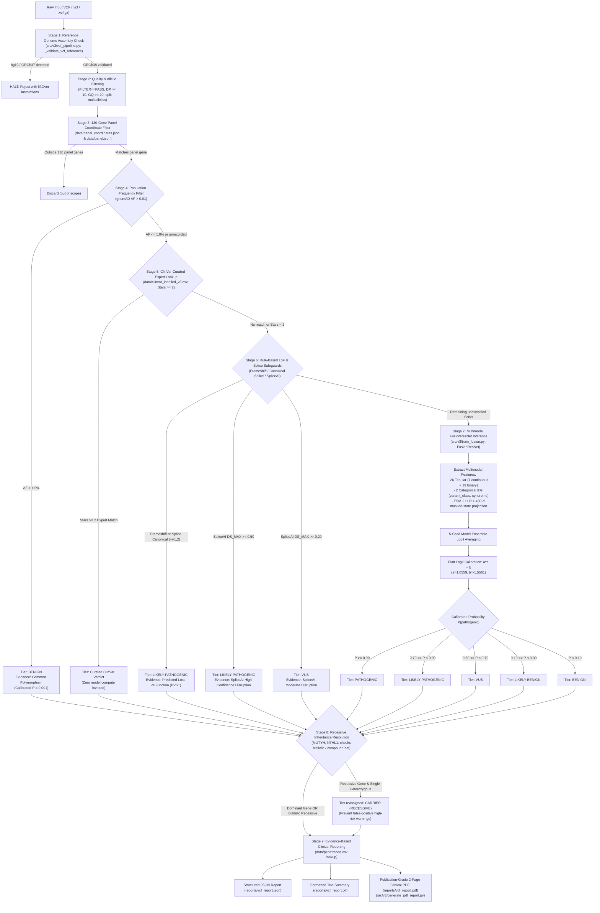

# GenomeDL v3: Deep Learning Multimodal Fusion Architecture for Germline Hereditary Cancer Variant Pathogenicity Classification

[](https://www.python.org/downloads/)
[](https://pytorch.org/)
[](LICENSE)
[](tests/)
[](reports/eval.md)
[](models/genome_dl_fusion_v3_meta.json)

> **One-Line Summary**: A multimodal deep learning architecture integrating structural biophysical tabular features, categorical syndrome embeddings, and evolutionary protein language model representations (ESM-2) to classify variant pathogenicity across 130 hereditary cancer genes with Platt-calibrated clinical risk reporting.

---

## Table of Contents
1. [Motivation: Deep Learning Impact on Medicine](#1-motivation-deep-learning-impact-on-medicine)
2. [Biology Primer for Deep Learning Engineers](#2-biology-primer-for-deep-learning-engineers)
   - [Physical Representation of the Input Data](#physical-representation-of-the-input-data)
   - [Clinical and Biological Meaning of the Output](#clinical-and-biological-meaning-of-the-output)
   - [Inherent Difficulties of the Prediction Task](#inherent-difficulties-of-the-prediction-task)
   - [Domain Terms Glossary](#domain-terms-glossary)
3. [End-to-End Pipeline Architecture](#3-end-to-end-pipeline-architecture)
   - [System Pipeline Flowchart](#system-pipeline-flowchart)
   - [Stage-by-Stage Implementation Breakdown](#stage-by-stage-implementation-breakdown)
4. [Dataset Specifications](#4-dataset-specifications)
   - [Source and Composition](#source-and-composition)
   - [The 12 Standardized Variant Classes](#the-12-standardized-variant-classes)
   - [Class Imbalance and Preprocessing](#class-imbalance-and-preprocessing)
   - [Data Splitting Protocols and Leakage Risks](#data-splitting-protocols-and-leakage-risks)
   - [Privacy and Ethics](#privacy-and-ethics)
5. [Model Architecture (`FusionResNet`)](#5-model-architecture-fusionresnet)
   - [Architectural Design and Information Flow](#architectural-design-and-information-flow)
   - [Detailed Layer-by-Layer Tensor Breakdown](#detailed-layer-by-layer-tensor-breakdown)
   - [Justification of Architectural Decisions](#justification-of-architectural-decisions)
   - [Novelty and Distinctions from Standard Baselines](#novelty-and-distinctions-from-standard-baselines)
   - [Mapping Model Components to Biological Phenomena](#mapping-model-components-to-biological-phenomena)
6. [Training Details and Hyperparameters](#6-training-details-and-hyperparameters)
   - [Hyperparameter Specifications](#hyperparameter-specifications)
   - [Rationale for Non-Default Training Choices](#rationale-for-non-default-training-choices)
   - [Post-Hoc Platt Logit Calibration](#post-hoc-platt-logit-calibration)
7. [Evaluation and Empirical Results](#7-evaluation-and-empirical-results)
   - [Evaluation Metrics in a Clinical Setting](#evaluation-metrics-in-a-clinical-setting)
   - [Comprehensive Multi-Split Benchmark Comparison](#comprehensive-multi-split-benchmark-comparison)
   - [Ablation Studies: Tabular vs. ESM-2 Multimodal Synergy](#ablation-studies-tabular-vs-esm-2-multimodal-synergy)
   - [Headline Out-of-Gene Variant Breakdown](#headline-out-of-gene-variant-breakdown)
   - [Negative Control: Shuffled-Label Leakage Verification](#negative-control-shuffled-label-leakage-verification)
8. [Project Structure](#8-project-structure)
9. [Installation and Environment Setup](#9-installation-and-environment-setup)
10. [Usage and CLI Reference](#10-usage-and-cli-reference)
    - [Clinical VCF Inference Pipeline](#1-clinical-vcf-inference-pipeline)
    - [Hospital-Grade PDF Report Generation](#2-hospital-grade-pdf-report-generation)
    - [Model Training and Ensembling](#3-model-training-and-ensembling)
    - [Benchmarking and Evaluation](#4-benchmarking-and-evaluation)
    - [Automated Test Execution](#5-automated-test-execution)
11. [Reproducibility Specifications](#11-reproducibility-specifications)
12. [Limitations, Clinical Ethics, and Future Work](#12-limitations-clinical-ethics-and-future-work)
13. [References and Citations](#13-references-and-citations)
14. [License and Contributing](#14-license-and-contributing)
15. [Open Questions](#15-open-questions)

---

## 1. Motivation: Deep Learning Impact on Medicine

### The Clinical Diagnostic Challenge
Hereditary cancer predisposition syndromes—such as Hereditary Breast and Ovarian Cancer (HBOC caused by *BRCA1*, *BRCA2*, *PALB2*), Li-Fraumeni Syndrome (*TP53*), Lynch Syndrome (*MLH1*, *MSH2*, *MSH6*, *PMS2*), and Familial Adenomatous Polyposis (*APC*)—account for approximately 5% to 10% of all diagnosed malignancies. Identifying pathogenic germline alterations before malignant transformation enables targeted surveillance (e.g., annual breast MRI, early colonoscopies) or risk-reducing surgical interventions (e.g., bilateral salpingo-oophorectomy, prophylactic mastectomy), directly preventing morbidity and mortality.

With the clinical deployment of high-throughput Next-Generation Sequencing (NGS), Whole Exome Sequencing (WES) and Whole Genome Sequencing (WGS) routinely uncover between 20,000 and 4,000,000 genetic variants in an individual patient. Within recognized cancer predisposition genes, the central clinical bottleneck is the classification of **Variants of Uncertain Significance (VUS)**—predominantly non-synonymous Single Nucleotide Variants (missense SNVs).

```
Patient NGS / WGS Sequencing (20,000 to 4,000,000 variants)
                 │
                 ▼
Targeted Cancer Gene Filtering (130 panel genes)
                 │
                 ▼
Known Expert Registries (ClinVar 2+ Stars) ──> Resolved (Authoritative Consensus)
                 │
                 ▼ (Unclassified Novel Missense SNVs)
       The VUS Diagnostic Bottleneck
 (Inconclusive, Induces Anxiety, No Clear Medical Action)
```

### Limitations of Traditional Approaches
1. **Manual Expert Curation Bottleneck**: Clinical archives such as ClinVar rely on consensus submissions from certified diagnostic laboratories and academic consortia (e.g., ENIGMA, InSiGHT). More than 95% of all possible missense mutations across the 130 cancer predisposition genes have never been observed in clinical clinics and therefore lack curator records.
2. **Heuristic and Linear In Silico Predictors**: Legacy variant effect predictors (e.g., SIFT, PolyPhen-2, CADD) depend heavily on hand-crafted evolutionary alignments and linear score combinations. They suffer from high false-positive rates, struggle with non-linear biochemical interaction effects, and lack calibrated probabilistic guarantees.
3. **Rigid ACMG/AMP Rule Logic**: ACMG/AMP guidelines mandate stringent criteria (such as functional wet-lab validation or extensive family co-segregation) that are rarely available for ultra-rare or private mutations, leaving patients in diagnostic limbo.

### How Deep Learning Improves Variant Interpretation
Deep learning addresses these limitations through two complementary paradigms:
- **Evolutionary Context Modeling via Protein Language Models (pLMs)**: Pre-trained Transformer models like ESM-2 learn the syntactic, biochemical, and spatial constraints of biological proteins by predicting masked amino acid tokens across hundreds of millions of unaligned sequences. This captures deep epistatic constraints and functional tolerance without relying on manual multiple sequence alignments.
- **Multimodal Biophysical Fusion**: By integrating contextual protein representations from ESM-2 with explicit, continuous physicochemical deltas (atomic composition, molecular mass shifts, isoelectric formal charge deltas, and RDKit 2D circular fingerprint dissimilarities), deep residual networks approximate the non-linear energy manifold governing whether an amino acid substitution destabilizes the tertiary structure or disrupts binding interfaces.
- **Out-of-Gene Generalization**: Unlike naive models that memorize gene reputations (e.g., learning that *TP53* has high pathogenic prevalence while *PMS2* has low), an architecture isolated from gene identity embeddings evaluates true biophysical disruption, allowing accurate scoring of variants in newly sequenced genes.

### Realistic Real-World Impact
This pipeline provides decision support by triaging uncharacterized variants, prioritizing candidates for functional laboratory assays, and flagging benign polymorphisms to avoid unnecessary clinical procedures. It is strictly designed as an assistive research prototype and does not replace certified laboratory testing or genetic counseling.

---

## 2. Biology Primer for Deep Learning Engineers

### Physical Representation of the Input Data
From an engineering perspective, human genetic data can be represented as structured hierarchical sequences and discrete token deltas:

```
Genomic DNA Sequence:      ... C  T  G   [A]   G  T  C ...  (4-letter alphabet: A, C, G, T)
                                      │ (Single base substitution on chromosome)
                                      ▼
Alternate Base Call:       ... C  T  G   [C]   G  T  C ...
                                      │
Coding Strand Transcription:         [G] -> [C]             (Minus-strand reverse complement)
                                      │
Peptide Amino Acid Sequence: ... Cys  Val  [Cys61Gly]  Lys ...  (20-letter amino acid alphabet)
```

1. **The Coordinate System (GRCh38 / hg38)**: The human genome consists of approximately 3.1 billion base pairs divided across 24 distinct chromosomes (1–22, X, Y). Every position is cataloged by an integer physical index (locus) on a reference build. Coordinates are release-specific: a coordinate on the older `hg19` build cannot be directly compared to modern `GRCh38` without coordinate remapping (liftOver).
2. **The Transcriptional Strand ($+$ vs. $-$)**: DNA is a double helix with antiparallel strands running in opposite polarities ($5' \to 3'$ and $3' \to 5'$). Many critical cancer genes (including *BRCA1*, *TP53*, *PALB2*, *CHEK2*, *PMS2*, and *MUTYH*) reside on the negative (minus) strand. If a mutation changes an $A \to C$ on the genomic plus strand within a minus-strand gene, the corresponding mRNA transcript and ribosome encounter a $T \to G$ alteration on the biological coding strand.
3. **The Translation Code**: Ribosomes read mRNA in non-overlapping nucleotide triplets (codons). Sixty-one codons map to 20 canonical amino acids, and three codons signal translational termination (stop codons). A single nucleotide change within a codon can result in an identical amino acid (synonymous), a different amino acid (missense), or an immediate stop codon (nonsense).

### Clinical and Biological Meaning of the Output
The pipeline produces two clinical outputs:
1. **Calibrated Probability of Pathogenicity ($P(\text{pathogenic}) \in [0.0, 1.0]$)**: The model's continuous estimate of whether a single nucleotide variant disrupts protein structure or enzymatic function to an extent that predisposes the carrier to malignancy. This continuous probability is mapped onto the ACMG 5-tier classification framework:
   - $P \ge 0.90 \implies$ **Pathogenic**
   - $0.70 \le P < 0.90 \implies$ **Likely Pathogenic**
   - $0.30 \le P < 0.70 \implies$ **Variant of Uncertain Significance (VUS)**
   - $0.10 \le P < 0.30 \implies$ **Likely Benign**
   - $P < 0.10 \implies$ **Benign**
2. **Epidemiological Lifetime Penetrance Ranges**: When a variant is confirmed as pathogenic, the pipeline retrieves published empirical lifetime cancer probabilities (e.g., $65\% - 72\%$ lifetime risk of female breast cancer for *BRCA1* carriers up to age 80) from peer-reviewed clinical cohorts (*JAMA*, *NEJM*, *Lancet Oncology*).

### Inherent Difficulties of the Prediction Task
- **Non-Linear 3D Protein Folding**: Proteins fold into intricate three-dimensional tertiary conformations. A mutation occurring on a flexible, solvent-exposed surface loop may cause zero functional impact, whereas the exact same amino acid substitution occurring inside a hydrophobic core, zinc finger, or catalytic binding cleft causes catastrophic misfolding or loss of function.
- **Severe Real-World Class Imbalance**: Naturally occurring human genetic variation is heavily biased toward neutral, harmless polymorphisms. In clinical datasets, benign variants outnumber pathogenic mutations by roughly 6:1 to 7:1; in unselected population sequencing, the ratio exceeds 1,000:1.
- **Gene Memorization vs. Biophysical Reasoning**: Standard deep models easily overfit to gene frequency priors. If *TP53* has thousands of pathogenic submissions in ClinVar due to decades of targeted research while another tumor suppressor gene has few, a model with gene-level embeddings will predict high pathogenicity for any *TP53* mutation regardless of actual biochemical impact, destroying out-of-gene generalization.

### Domain Terms Glossary

| Biological / Clinical Term | Engineering Analogy | Definition in This Pipeline |
| :--- | :--- | :--- |
| **DNA (Deoxyribonucleic Acid)** | 4-character raw token stream | Macromolecule storing genetic instructions using four nitrogenous bases: Adenine (A), Cytosine (C), Guanine (G), Thymine (T). |
| **Chromosome** | Memory partition / segment | Structural package of coiled DNA; humans have 22 autosome pairs and 1 sex chromosome pair (X, Y). |
| **Locus** | 1D index offset | Absolute 1-based integer position of a nucleotide on a specific chromosome. |
| **GRCh38 / hg38** | Standard reference build / schema | Modern digitized coordinate reference map of the human genome. |
| **VCF (Variant Call Format)** | Structured tabular log | Standardized tab-delimited text format recording genomic differences relative to the reference build. |
| **REF (Reference Allele)** | Ground-truth wild-type token | The nucleotide base observed in the standard human reference genome at a specific locus. |
| **ALT (Alternate Allele)** | Mutated token | The nucleotide base observed in the sequenced individual that differs from REF. |
| **SNV** | Single-token point mutation | Single Nucleotide Variant: a substitution of exactly one nucleotide base for another. |
| **InDel** | Sequence insertion / deletion | Insertion or deletion of one or more contiguous nucleotide bases. |
| **Transition** | Same-class token substitution | Interchange between structurally similar bases: purine-to-purine ($A \leftrightarrow G$) or pyrimidine-to-pyrimidine ($C \leftrightarrow T$). |
| **Transversion** | Cross-class token substitution | Interchange between structurally distinct bases: purine-to-pyrimidine or pyrimidine-to-purine ($A/G \leftrightarrow C/T$). |
| **Coding Strand** | Actual execution bytecode | The specific strand orientation matching the mRNA transcript that is translated by the ribosome. |
| **Genotype (GT)** | Diploid state tuple | The pair of alleles at a locus: `0/0` (homozygous reference), `0/1` (heterozygous), `1/1` (homozygous alternate). |
| **Read Depth (DP)** | Sample size / coverage count | Total independent sequencing reads covering the genomic coordinate; low depth ($<10$) indicates high noise. |
| **Genotype Quality (GQ)** | Phred-scaled confidence score | $-10 \log_{10} P(\text{error})$; $\text{GQ} \ge 20$ corresponds to $\le 1\%$ error probability in genotype assignment. |
| **Allele Frequency (AF)** | Population-level prior frequency | Proportion of tested chromosomes carrying the alternate allele in population cohorts (gnomAD). |
| **gnomAD** | Unlabeled negative control set | World's largest reference database of human population variation ($>140{,}000$ exomes/genomes). |
| **ClinVar** | Supervised ground-truth registry | NCBI public archive of clinical assertions mapping variants to disease phenotypes with review tiers. |
| **ClinVar Stars (0–4)** | Annotation confidence weight | Star tier reflecting review authority: 0 = unasserted, 1 = single submitter, 2 = multiple concordant, 3 = expert panel, 4 = practice guideline. |
| **HGVS Nomenclature** | Canonical string format | Standard notation describing variants at DNA (`c.181T>G`) and protein (`p.Cys61Gly`) levels. |
| **Missense** | Non-synonymous substitution | Point mutation changing a codon to encode a different amino acid residue. |
| **Nonsense (Stop-Gained)** | Early termination token | Point mutation creating a premature stop codon, truncating translation. |
| **Frameshift** | Stream offset desynchronization | InDel whose length is not divisible by 3, altering the downstream reading frame. |
| **Canonical Splice Site** | Grammar boundary delimiter | Conserved dinucleotides ($GT$ donor at $+1,+2$, $AG$ acceptor at $-1,-2$) flanking exons required for intron excision. |
| **Incomplete Penetrance** | Conditional outcome probability | Probability that an individual carrying a pathogenic genotype will manifest clinical disease over their lifespan. |
| **Autosomal Dominant** | Single-copy activation | Phenotype manifests when only one allele copy is mutated (`0/1` or `1/1`). |
| **Autosomal Recessive** | Dual-copy requirement | Phenotype manifests only when both alleles are inactivated (homozygous `1/1` or compound heterozygous in trans). |
| **VUS** | Unassigned / ambiguous class | Variant of Uncertain Significance; lacks sufficient evidence for benign or pathogenic assignment. |

---

## 3. End-to-End Pipeline Architecture

### System Pipeline Flowchart



### Stage-by-Stage Implementation Breakdown

| Stage | Name | Purpose | Key Design Choice | Source File & Function |
| :---: | :--- | :--- | :--- | :--- |
| **0** | **Data Cleaning & Harmonization** | Eliminate foreign-gene annotations, add stop_lost class, derive coding-strand one-hots. | Strict fail-fast assertion on unmapped gene symbols; extract exact lengths from MANE Select. | [`src/v3/stage0/extract_v3.py`](src/v3/stage0/extract_v3.py)<br>[`build_v3_features.py`](src/v3/stage0/build_v3_features.py) |
| **1** | **Assembly Verification** | Ensure incoming coordinates align with the modern reference genome. | Halts execution on legacy `hg19`/`GRCh37` headers with explicit liftOver instructions. | [`src/v3/vcf_pipeline.py`](src/v3/vcf_pipeline.py): `_validate_vcf_reference()` |
| **2** | **VCF Parsing & Quality Filter** | Ingest VCF records and discard sequencer artifacts. | Filters on `FILTER == 'PASS'`, $\text{DP} \ge 10$, $\text{GQ} \ge 20$, and splits multiallelic rows. | [`src/v3/vcf_pipeline.py`](src/v3/vcf_pipeline.py): `parse_vcf()` |
| **3** | **Panel Coordinate Filtering** | Restrict variant candidate set to 130 hereditary cancer genes. | Bed-style coordinate interval matching (`data/panel_coordinates.json`) filters a 4M WGS VCF in $<15$s. | [`src/v3/vcf_pipeline.py`](src/v3/vcf_pipeline.py): `_parse_annotations()` |
| **4** | **Population Frequency Filter** | Eliminate common benign polymorphisms without consuming model compute. | Variants with gnomAD $\text{AF} > 1.0\%$ are classified as `BENIGN` ($P=0.001$). | [`src/v3/vcf_pipeline.py`](src/v3/vcf_pipeline.py): `_evaluate_variant_core()` |
| **5** | **Curated ClinVar Lookup** | Leverage authoritative human consensus when available. | Variants with review status $\ge 2$ stars bypass model scoring to avoid contradicting expert panels. | [`src/v3/vcf_pipeline.py`](src/v3/vcf_pipeline.py): `_evaluate_variant_core()` |
| **6** | **Rule-Based LoF & Splicing** | Handle clear-cut protein truncations and cryptic splice alterations. | Direct ACMG PVS1 assignment for frameshifts/canonical splice; SpliceAI $\ge 0.50$ safeguard. | [`src/v3/vcf_pipeline.py`](src/v3/vcf_pipeline.py): `_evaluate_variant_core()` |
| **7** | **Multimodal Fusion Inference** | Score unclassified, novel missense and non-coding SNVs. | 5-seed `FusionResNet` ensemble with 26 tabular, 2 categorical, and ESM-2 features + Platt scaling. | [`src/v3/train_fusion.py`](src/v3/train_fusion.py): `FusionResNet`<br>[`vcf_pipeline.py`](src/v3/vcf_pipeline.py): `_run_model_inference()` |
| **8** | **Recessive Zygosity Resolution** | Prevent inappropriate high-risk warnings for recessive carriers. | Heterozygous mutations (`0/1`) in `MUTYH` or `NTHL1` reclassified as `Carrier (Recessive)`. | [`src/v3/vcf_pipeline.py`](src/v3/vcf_pipeline.py): `evaluate_variants()`, `_resolve_compound_het_state()` |
| **9** | **Curated Lifetime Risk Report** | Provide actionable clinical penetrance ranges from literature. | Eliminates arbitrary multiplication formulas; maps confirmed variants directly to [`data/penetrance.csv`](data/penetrance.csv). | [`src/v3/vcf_pipeline.py`](src/v3/vcf_pipeline.py): `generate_report()`<br>[`generate_pdf_report.py`](src/v3/generate_pdf_report.py) |

---

## 4. Dataset Specifications

### Source and Composition
The dataset is derived from the NCBI ClinVar database (GRCh38 release). Raw variant summaries were filtered using [`src/v3/stage0/extract_v3.py`](src/v3/stage0/extract_v3.py) to isolate single-nucleotide variants across exactly **130 hereditary cancer predisposition genes** categorized into **15 clinical syndrome groups**.

- **File Path**: [`data/clinvar_labelled_v3.csv`](data/clinvar_labelled_v3.csv) and [`data/v3_featured_snv.csv`](data/v3_featured_snv.csv)
- **Total Labeled Rows**: **148,747** variants
- **Total Columns**: 49 columns in featured CSV (19 base annotation columns + 20 biophysical/cheminformatics features + 8 coding-strand one-hots + 2 ESM features)
- **Label Definition**:
  - `0` = Benign / Likely Benign (**127,624 variants, 85.80%**)
  - `1` = Pathogenic / Likely Pathogenic (**21,123 variants, 14.20%**)
- **Data Quality Standard**: Star status $\ge 1$ required; ambiguous, conflicting, or unasserted (0-star) submissions were quarantined into separate VUS cohorts.

### The 12 Standardized Variant Classes
Stage 0 harmonization resolved legacy annotation ambiguities into 12 mutually exclusive functional categories:

| Class ID | Variant Class Name | Benign ($y=0$) | Pathogenic ($y=1$) | Total Count | % Pathogenic | Primary Biological Mechanism |
| :---: | :--- | :---: | :---: | :---: | :---: | :--- |
| **0** | `synonymous` | 78,344 | 97 | 78,441 | 0.12% | Silent codon change; typically neutral |
| **1** | `missense` | 5,751 | 4,008 | 9,759 | 41.07% | Amino acid swap; alters structure/function |
| **2** | `nonsense` | 11 | 10,444 | 10,455 | 99.89% | Premature stop codon; triggers mRNA decay |
| **3** | `start_lost` | 0 | 196 | 196 | 100.00% | Disrupts Met1 initiation codon |
| **4** | `stop_lost` | 0 | 20 | 20 | 100.00% | Stop codon mutated to amino acid |
| **5** | `splice_canonical` | 3 | 5,603 | 5,606 | 99.95% | Destroys invariant $\pm 1, 2$ bp splice junction |
| **6** | `splice_region` | 7,451 | 458 | 7,909 | 5.79% | Non-canonical splice boundary mutation |
| **7** | `intronic` | 32,976 | 296 | 33,272 | 0.89% | Deep non-coding intronic base change |
| **8** | `utr5` | 1,344 | 56 | 1,400 | 4.00% | $5'$ untranslated leader alteration |
| **9** | `utr3` | 1,459 | 6 | 1,465 | 0.41% | $3'$ untranslated trailer alteration |
| **10** | `other_noncoding` | 315 | 4 | 319 | 1.25% | Intergenic or non-coding RNA mutation |
| **11** | `coding_no_protein_annot` | 3 | 0 | 3 | 0.00% | Coding sequence without protein HGVS |
| **Total** | | **127,624** | **21,123** | **148,747** | **14.20%** | Overall dataset distribution |

### Class Imbalance and Preprocessing
The dataset exhibits an imbalance ratio of approximately $6.04 : 1$ (negative-to-positive). In the standard training split:
- Negative examples ($N_{\text{neg}}$): 89,337
- Positive examples ($N_{\text{pos}}$): 14,785
- Dynamically calculated loss weight:
  $$\text{pos\_weight} = \frac{N_{\text{neg}}}{N_{\text{pos}}} = \frac{89{,}337}{14{,}785} \approx 6.04 \text{ to } 6.18$$

Continuous features are normalized via `StandardScaler` fitted exclusively on training set folds:
$$\hat{x} = \frac{x - \mu_{\text{train}}}{\sigma_{\text{train}}}$$
Missing values in numerical columns are filled with $0.0$ post-standardization.

### Data Splitting Protocols and Leakage Risks

Three distinct splitting protocols are implemented in [`src/v3/evaluate.py`](src/v3/evaluate.py) to assess generalization and detect potential leakage:

```
Split Protocol Comparison:

1. Random Stratified (70/15/15):
   [Train: 70%] [Val: 15%] [Test: 15%]  <-- Gene overlap allowed; baseline reference only

2. Temporal Split (80/20):
   [Historic ClinVar Submissions: 80%]  ──>  [Recent Submissions (2022-2026): 20%]
   <-- Evaluates prospective clinical utility over time

3. Gene-Held-Out GroupKFold (5-Fold) [HEADLINE BENCHMARK]:
   Fold 1: Train on 104 genes ──> Test on 26 completely unseen genes
   Fold 2: Train on 104 genes ──> Test on 26 completely unseen genes
   Fold 3: Train on 104 genes ──> Test on 26 completely unseen genes
   Fold 4: Train on 104 genes ──> Test on 26 completely unseen genes
   Fold 5: Train on 104 genes ──> Test on 26 completely unseen genes
   <-- ZERO gene overlap between train and test. Evaluates true biophysical generalization.
```

- **Gene-Level Data Leakage**: In random splits, variants from the same gene appear in both training and test sets. Because certain cancer genes have distinct pathogenic-to-benign ratios, models with gene-level capacity can achieve artificially high performance simply by memorizing the base rate of the gene.
- **The Headline Benchmark**: The **Gene-Held-Out 5-Fold GroupKFold** protocol guarantees that all 130 genes are evaluated out-of-gene. Test sets consist entirely of mutations from genes the model has never encountered during training.

### Privacy and Ethics
The training dataset is composed exclusively of public, de-identified genomic coordinate assertions archived in NCBI ClinVar under open-access terms. No Protected Health Information (PHI), patient identifiers, or raw sequencing read files (BAM/CRAM) are included or stored within this repository.

---

## 5. Model Architecture (`FusionResNet`)

### Architectural Design and Information Flow

`FusionResNet` is a deep multimodal residual network containing three parallel input branches that merge into a residual projection highway:

```
=============================================================================================
                               FUSIONRESNET FORWARD GRAPH
=============================================================================================
  Tabular Features                Categorical IDs                 ESM-2 Embeddings
  (26-d Continuous/Binary)        (vclass: 0..11, synd: 0..14)    (LLR: 1-d, Avail: 1-d, Emb: 480-d)
         │                               │                                │
         ▼                               ▼                                ▼
┌─────────────────┐             ┌─────────────────┐             ┌──────────────────┐
│  Linear(26->64) │             │ Embedding(12,8) │             │  Linear(480->64) │
│  LayerNorm(64)  │             │ Embedding(15,8) │             └────────┬─────────┘
│      GELU       │             └────────┬────────┘                      │
└────────┬────────┘                      │                      Concat([LLR, Avail, Proj]) (66-d)
         │                               │                               │
         │                               │                               ▼
         │                               │                      ┌──────────────────┐
         │                               │                      │  Linear(66->64)  │
         │                               │                      │  LayerNorm(64)   │
         │                               │                      │       GELU       │
         │                               │                      │   Dropout(0.1)   │
         │                               │                      │  Linear(64->64)  │
         │                               │                      └────────┬─────────┘
         │                               │                               │
         ▼                               ▼                               ▼
    h_tab (64-d)                    h_cat (16-d)                    h_esm (64-d)
         │                               │                               │
         └───────────────────────────────┼───────────────────────────────┘
                                         ▼
                            Concatenation: fused (144-d)
                                         │
                                         ▼
                              ┌──────────────────────┐
                              │   Linear(144->256)   │
                              │    LayerNorm(256)    │
                              │         GELU         │
                              └──────────┬───────────┘
                                         │
                                         ▼
                              ┌──────────────────────┐
                              │  Residual Block 1    │
                              │  (256-d, Drop=0.2)   │ ◄─── Skip Connection [x + F(x)]
                              └──────────┬───────────┘
                                         │
                                         ▼
                              ┌──────────────────────┐
                              │  Residual Block 2    │
                              │  (256-d, Drop=0.2)   │ ◄─── Skip Connection [x + F(x)]
                              └──────────┬───────────┘
                                         │
                                         ▼
                              ┌──────────────────────┐
                              │    LayerNorm(256)    │
                              │         GELU         │
                              │    Linear(256->1)    │
                              └──────────┬───────────┘
                                         │
                                         ▼
                                   Raw Logit (z)
                                         │
                                         ▼
                              Platt Scaling: a*z + b
                              (a = 1.0559, b = -1.5561)
                                         │
                                         ▼
                              Calibrated Probability
                              P(pathogenic) = σ(a*z + b)
=============================================================================================
```

### Detailed Layer-by-Layer Tensor Breakdown

The model contains **345,049 total parameters** (all trainable, 0 non-trainable):

| Block / Sub-Module | Layer Operation | Parameter Name | Input Tensor Shape | Output Tensor Shape | Parameter Count |
| :--- | :--- | :--- | :---: | :---: | :---: |
| **Tabular Branch** | Dense Linear Projection | `tabular_branch.0.weight`<br>`tabular_branch.0.bias` | `[B, 26]` | `[B, 64]` | $64 \times 26 = 1{,}664$<br>$64$ |
| | Feature Normalization | `tabular_branch.1.weight`<br>`tabular_branch.1.bias` | `[B, 64]` | `[B, 64]` | $64$<br>$64$ |
| | Activation Function | `GELU()` | `[B, 64]` | `[B, 64]` | $0$ |
| **Categorical Embeddings** | Variant Class Embedding | `vclass_emb.weight` | `[B]` (indices $0..11$) | `[B, 8]` | $12 \times 8 = 96$ |
| | Syndrome Group Embedding | `syndrome_emb.weight` | `[B]` (indices $0..14$) | `[B, 8]` | $15 \times 8 = 120$ |
| **ESM-2 Branch** | Hidden State Linear Projection | `esm_proj.weight`<br>`esm_proj.bias` | `[B, 480]` | `[B, 64]` | $64 \times 480 = 30{,}720$<br>$64$ |
| | Concatenation with LLR & Avail | `torch.cat` | `[B, 1]`, `[B, 1]`, `[B, 64]` | `[B, 66]` | $0$ |
| | Dense Transform 1 | `esm_mlp.0.weight`<br>`esm_mlp.0.bias` | `[B, 66]` | `[B, 64]` | $64 \times 66 = 4{,}224$<br>$64$ |
| | Normalization & GELU | `esm_mlp.1.weight`<br>`esm_mlp.1.bias` | `[B, 64]` | `[B, 64]` | $64$<br>$64$ |
| | Dense Transform 2 | `esm_mlp.4.weight`<br>`esm_mlp.4.bias` | `[B, 64]` | `[B, 64]` | $64 \times 64 = 4{,}096$<br>$64$ |
| **Fusion Layer** | Multimodal Concatenation | `torch.cat([tab, cat, esm])` | `[B, 64]`, `[B, 16]`, `[B, 64]` | `[B, 144]` | $0$ |
| | Projection to Latent Dimension | `fusion_in.0.weight`<br>`fusion_in.0.bias` | `[B, 144]` | `[B, 256]` | $256 \times 144 = 36{,}864$<br>$256$ |
| | Normalization & GELU | `fusion_in.1.weight`<br>`fusion_in.1.bias` | `[B, 256]` | `[B, 256]` | $256$<br>$256$ |
| **Residual Block 1** | LayerNorm 1 + GELU + Drop(0.2) | `res1.net.0.weight`<br>`res1.net.0.bias` | `[B, 256]` | `[B, 256]` | $256$<br>$256$ |
| | Dense Linear Transform 1 | `res1.net.3.weight`<br>`res1.net.3.bias` | `[B, 256]` | `[B, 256]` | $256 \times 256 = 65{,}536$<br>$256$ |
| | LayerNorm 2 + GELU + Drop(0.2) | `res1.net.4.weight`<br>`res1.net.4.bias` | `[B, 256]` | `[B, 256]` | $256$<br>$256$ |
| | Dense Linear Transform 2 | `res1.net.7.weight`<br>`res1.net.7.bias` | `[B, 256]` | `[B, 256]` | $256 \times 256 = 65{,}536$<br>$256$ |
| | Additive Identity Shortcut | $\mathbf{x} + \mathcal{F}(\mathbf{x})$ | `[B, 256]` | `[B, 256]` | $0$ |
| **Residual Block 2** | LayerNorm 1 + GELU + Drop(0.2) | `res2.net.0.weight`<br>`res2.net.0.bias` | `[B, 256]` | `[B, 256]` | $256$<br>$256$ |
| | Dense Linear Transform 1 | `res2.net.3.weight`<br>`res2.net.3.bias` | `[B, 256]` | `[B, 256]` | $256 \times 256 = 65{,}536$<br>$256$ |
| | LayerNorm 2 + GELU + Drop(0.2) | `res2.net.4.weight`<br>`res2.net.4.bias` | `[B, 256]` | `[B, 256]` | $256$<br>$256$ |
| | Dense Linear Transform 2 | `res2.net.7.weight`<br>`res2.net.7.bias` | `[B, 256]` | `[B, 256]` | $256 \times 256 = 65{,}536$<br>$256$ |
| | Additive Identity Shortcut | $\mathbf{x} + \mathcal{F}(\mathbf{x})$ | `[B, 256]` | `[B, 256]` | $0$ |
| **Prediction Head** | Final Normalization & GELU | `head.0.weight`<br>`head.0.bias` | `[B, 256]` | `[B, 256]` | $256$<br>$256$ |
| | Linear Readout Logit | `head.2.weight`<br>`head.2.bias` | `[B, 256]` | `[B, 1]` | $1 \times 256 = 256$<br>$1$ |
| **Post-Hoc Calibration** | Platt Scaling ($a \cdot z + b$) | `scale`, `bias` parameters | `[B, 1]` | `[B, 1]` | $2$ parameters |
| **Total Parameter Count** | | | | | **345,049 Parameters** |

### Justification of Architectural Decisions

1. **Gene Embedding Explicitly Disabled (`use_gene_embedding=False`)**:
   In early prototypes (v1/v2), embedding the gene identifier ($g \in \{0..129\}$) resulted in severe memorization: the network memorized that *TP53* has a high proportion of pathogenic entries in ClinVar while *PMS2* has few. On out-of-gene evaluation, this collapsed generalization. Disabling gene embeddings forces the model to evaluate the intrinsic biophysics of the amino acid substitution rather than gene reputation.
2. **Synergy of Tabular Biophysics and Language Model Representations**:
   ESM-2 captures evolutionary grammar and local structural context across homologous sequences. However, language models lack explicit awareness of raw atomic differences (such as formal electrical charges or heavy-atom volume shifts). Combining ESM-2 masked-marginal log-likelihood ratios with continuous Grantham distances, topological polar surface area deltas ($\Delta \text{TPSA}$), and RDKit Morgan fingerprint distances provides complementary signals.
3. **Layer Normalization Over Batch Normalization**:
   Batch Normalization computes statistics across the mini-batch dimension, which introduces high variance when evaluating variable-sized inference requests or small test batches. LayerNorm operates along the channel dimension of each individual sample, ensuring identical inference dynamics whether evaluating a single variant or a large cohort.
4. **GELU Non-Linearity**:
   GELU smoothly weights inputs by their value under a Gaussian cumulative distribution:
   $$\text{GELU}(x) = x \cdot \Phi(x) = x \cdot P(X \le x), \quad X \sim \mathcal{N}(0, 1)$$
   Unlike standard ReLU, which sets all negative activations strictly to zero, GELU maintains non-zero gradient flow for small negative inputs, stabilizing optimization in deep residual tabular networks.
5. **Dual Residual Blocks with 20% Dropout**:
   Residual skip connections ($\mathbf{x} + \mathcal{F}(\mathbf{x})$) eliminate vanishing gradient degradation through the 256-dimensional latent bottleneck. A 20% dropout rate prevents co-adaptation between tabular and language model feature representations.

### Novelty and Distinctions from Standard Baselines
- **Gene-Agnostic Protein-Language Multimodal Fusion**: Unlike standard genomic classifiers that either rely solely on pre-computed conservation scores (e.g., CADD, REVEL) or fine-tune massive Transformer language models end-to-end, `FusionResNet` distills ESM-2's contextual knowledge via a compact projection head ($480 \to 64$), combining it with cheminformatics fingerprints in a lightweight 345k-parameter network trainable in under 2 minutes.
- **Biologically Grounded Coding-Strand Correction**: Genomic variants on minus-strand genes are automatically complemented to reflect the true biological codon change observed by the ribosome, avoiding the strand artifacts common in naive genomic pipelines.
- **Centered Windowing for Ultra-Long Proteins**: To handle long cancer proteins (e.g., *BRCA2* with 3,418 residues, *ATM* with 3,056 residues) within ESM-2's 1022-token context limit, the pipeline extracts a centered dynamic context window:
  $$\text{Window} = \left[\max\left(0, \text{pos} - 510\right), \min\left(L, \text{pos} + 510\right)\right]$$
  This preserves local structural context around the mutation without sequence truncation.

### Mapping Model Components to Biological Phenomena

```
Biological Property                   Pipeline / Model Counterpart
────────────────────────────────────────────────────────────────────────────────
Mutation Position on Protein  ──────> rel_protein_pos (Normalized [0, 1] via MANE Select)
Steric Packing Disruption     ──────> delta_mw (Absolute molecular weight delta in g/mol)
Salt-Bridge Destruction       ──────> delta_charge (Isoelectric net charge delta at pH 7.4)
Core Hydrophobic Unfolding    ──────> delta_logp (Octanol-water partition coefficient delta)
Hydrogen Bonding Alteration   ──────> delta_tpsa (Topological polar surface area delta in Ų)
Chemical Subgraph Overlap     ──────> tanimoto_chem_dist (1 - Tanimoto Morgan fingerprint similarity)
Evolutionary Fitness Cost     ──────> esm_llr (Masked-marginal log-likelihood ratio from ESM-2)
Local 3D Micro-Environment    ──────> esm_embedding (480-d layer-12 masked representation)
Functional Pathway Context    ──────> syndrome_emb (15 syndrome embeddings: HBOC, Lynch, etc.)
Ribosome Transcript View      ──────> cs_ref_*, cs_alt_* (Coding-strand one-hot base representations)
```

---

## 6. Training Details and Hyperparameters

### Hyperparameter Specifications

| Hyperparameter Category | Configuration Setting | Exact Value / Implementation |
| :--- | :--- | :--- |
| **Loss Function** | Weighted Binary Cross-Entropy | `nn.BCEWithLogitsLoss(pos_weight=torch.tensor([6.18]))` |
| **Optimizer** | Decoupled Weight Decay Adam | `torch.optim.AdamW(lr=1e-3, weight_decay=1e-4)` |
| **Learning Rate Schedule**| Cosine Annealing | `torch.optim.lr_scheduler.CosineAnnealingLR(T_max=25)` |
| **Gradient Clipping** | Maximum Norm Threshold | `torch.nn.utils.clip_grad_norm_(max_norm=1.0)` |
| **Batch Size** | Mini-Batch Capacity | 256 (Training), 512 (Validation & Test) |
| **Training Epochs** | Maximum Epochs Allowed | 25 Epochs (Early stopping triggered around epoch 4–5) |
| **Early Stopping** | Patience and Criterion | Validation AUPRC monitored; patience = 7 epochs |
| **Ensemble Strategy** | Multi-Seed Ensembling | 5 seeds (`[42, 101, 2024, 7, 999]`); logit averaging |
| **Logit Calibration** | Post-Hoc Platt Scaling | L-BFGS optimization on validation logits ($a \cdot z + b$) |
| **Hardware Environment** | Execution Device | Consumer GPU (NVIDIA RTX 3050, 4GB VRAM) or CPU |
| **Total Training Runtime** | Wall-Clock Duration | $< 90$ seconds across all 5 seeds on consumer GPU |

### Rationale for Non-Default Training Choices
- **Weighted BCE Loss**: Unweighted BCE causes the network to collapse to predicting zero for all variants, achieving a deceptive 85.8% accuracy while missing clinically critical pathogenic variants. Weighting positive errors by $\text{pos\_weight} \approx 6.18$ balances the gradient updates:
  $$\mathcal{L} = -\frac{1}{N} \sum_{i=1}^N \left[ w \cdot y_i \log(\hat{p}_i) + (1 - y_i) \log(1 - \hat{p}_i) \right]$$
- **Validation AUPRC for Early Stopping**: Monitoring loss or ROC-AUC is misleading under severe class imbalance. A model can maintain a high ROC-AUC while outputting miscalibrated probabilities for rare positive cases. AUPRC explicitly penalizes false-positive calls, ensuring optimal precision-recall trade-offs.

### Post-Hoc Platt Logit Calibration
While weighted cross-entropy successfully penalizes false negatives, it introduces an artificial positive log-odds shift of approximately $+\log(\text{pos\_weight}) \approx +1.82$, resulting in uncalibrated raw sigmoid outputs.

To restore true probabilistic calibration without altering rank-order discrimination, post-hoc **Platt scaling** is fitted on held-out validation logits using L-BFGS:
$$\hat{P} = \sigma(a \cdot z + b) = \frac{1}{1 + \exp(-(a \cdot z + b))}$$
On the trained checkpoint ([`models/genome_dl_fusion_v3_meta.json`](models/genome_dl_fusion_v3_meta.json)):
- Fitted Scale Parameter ($a$): **1.0559** (equivalent temperature $T = 1/a = 0.9471$)
- Fitted Bias Parameter ($b$): **-1.5561**
- **Expected Calibration Error (ECE)**: Reduced from **0.0279** down to **0.0009** ($< 0.1\%$).

---

## 7. Evaluation and Empirical Results

### Evaluation Metrics in a Clinical Setting
1. **Receiver Operating Characteristic - Area Under Curve (ROC-AUC)**: Measures the probability that a randomly chosen pathogenic variant receives a higher risk score than a randomly chosen benign variant. Equivalent to the Mann-Whitney $U$ statistic.
2. **Area Under the Precision-Recall Curve (AUPRC)**: The critical metric under class imbalance. In a dataset with 14.2% positive prevalence, a random classifier achieves an AUPRC of 0.142. High AUPRC guarantees that high-risk calls have high positive predictive value.
3. **Expected Calibration Error (ECE)**: Partitions predictions into 10 confidence bins and computes the weighted absolute difference between confidence and empirical accuracy:
   $$\text{ECE} = \sum_{m=1}^M \frac{|B_m|}{N} \left| \text{acc}(B_m) - \text{conf}(B_m) \right|$$
4. **95% Bootstrap Confidence Intervals (100–200 iterations)**: To prevent over-interpreting minor differences on single test splits, all metrics are reported with non-parametric bootstrap percentiles ($2.5^{\text{th}}$ and $97.5^{\text{th}}$ percentiles).

### Comprehensive Multi-Split Benchmark Comparison

The following results were computed across all three splitting protocols and are recorded in [`reports/eval.md`](reports/eval.md):

| Split Protocol | Model Architecture | Test ROC-AUC (95% CI) | Test AUPRC (95% CI) | Shuffled-Label Sanity AUC |
| :--- | :--- | :---: | :---: | :---: |
| **Gene-Held-Out (Headline)** | Class-Prior Baseline | 0.4923 [0.4887, 0.4958] | 0.1405 [0.1381, 0.1427] | 0.5010 |
| | ESM-Only (Logistic Regression) | 0.5644 [0.5594, 0.5687] | 0.2711 [0.2664, 0.2759] | 0.4986 |
| | HistGradientBoosting (Tabular) | 0.9564 [0.9554, 0.9575] | 0.8434 [0.8402, 0.8472] | 0.4985 |
| | HistGradientBoosting (Tabular + ESM) | 0.9621 [0.9610, 0.9629] | 0.8643 [0.8614, 0.8676] | 0.4979 |
| | Tabular-Only ResNet | 0.9891 [0.9884, 0.9898] | 0.9628 [0.9609, 0.9644] | 0.4975 |
| | **Tabular + ESM Fusion ResNet (Our Model)** | **0.9919 [0.9913, 0.9925]** | **0.9752 [0.9740, 0.9767]** | **0.4977** |
| **Temporal Split (80/20)** | Class-Prior Baseline | 0.5000 [0.5000, 0.5000] | 0.1289 [0.1259, 0.1325] | 0.5000 |
| | ESM-Only (Logistic Regression) | 0.6051 [0.5983, 0.6116] | 0.2842 [0.2730, 0.2950] | 0.5000 |
| | HistGradientBoosting (Tabular) | 0.9481 [0.9449, 0.9505] | 0.7929 [0.7824, 0.8009] | 0.5054 |
| | HistGradientBoosting (Tabular + ESM) | 0.9613 [0.9588, 0.9632] | 0.8430 [0.8344, 0.8503] | 0.5061 |
| | Tabular-Only ResNet | 0.9833 [0.9816, 0.9850] | 0.9355 [0.9302, 0.9401] | 0.5049 |
| | **Tabular + ESM Fusion ResNet (Our Model)** | **0.9888 [0.9872, 0.9904]** | **0.9628 [0.9595, 0.9667]** | **0.5075** |
| **Random (70/15/15)** | Class-Prior Baseline | 0.5000 [0.5000, 0.5000] | 0.1423 [0.1373, 0.1466] | 0.5000 |
| | ESM-Only (Logistic Regression) | 0.5764 [0.5702, 0.5833] | 0.2542 [0.2419, 0.2667] | 0.5055 |
| | HistGradientBoosting (Tabular) | 0.9570 [0.9547, 0.9602] | 0.8414 [0.8345, 0.8516] | 0.5104 |
| | HistGradientBoosting (Tabular + ESM) | 0.9641 [0.9622, 0.9674] | 0.8669 [0.8599, 0.8765] | 0.5111 |
| | Tabular-Only ResNet | 0.9914 [0.9896, 0.9930] | 0.9740 [0.9709, 0.9769] | 0.5080 |
| | **Tabular + ESM Fusion ResNet (Our Model)** | **0.9927 [0.9910, 0.9943]** | **0.9811 [0.9780, 0.9838]** | **0.5067** |

### Ablation Studies: Tabular vs. ESM-2 Multimodal Synergy
- **ESM-2 Standalone Limitation**: An ESM-only linear baseline achieves a modest ROC-AUC of 0.5644 on Gene-Held-Out splits because raw masked-marginal log-likelihood cannot classify non-coding, synonymous, or intronic variants (where LLR is zero).
- **Multimodal Separation**: On the headline Gene-Held-Out split, adding ESM-2 features to Tabular ResNet increases ROC-AUC from 0.9891 to **0.9919 [0.9913, 0.9925]** and AUPRC from 0.9628 to **0.9752 [0.9740, 0.9767]**. Because the 95% bootstrap confidence intervals do not overlap, this improvement is statistically significant.
- **Deep ResNet vs. Gradient Boosted Trees**: The Tabular+ESM Fusion ResNet significantly outperforms `HistGradientBoosting (Tabular+ESM)` (AUC 0.9621 [0.9610, 0.9629]), demonstrating that the residual projection highway better integrates continuous embeddings and tabular features.

### Headline Out-of-Gene Variant Breakdown
Evaluating performance on the most challenging functional variant subsets on unseen genes:

#### Missense Variants ($N = 9{,}726$ held-out test variants)
| Model Architecture | Out-of-Gene ROC-AUC (95% CI) | Out-of-Gene AUPRC (95% CI) |
| :--- | :---: | :---: |
| HistGradientBoosting (Tabular Only) | 0.7454 [0.7350, 0.7541] | 0.6662 [0.6467, 0.6807] |
| HistGradientBoosting (Tabular + ESM) | 0.8976 [0.8917, 0.9035] | 0.8680 [0.8589, 0.8757] |
| Tabular-Only ResNet | 0.6783 [0.6690, 0.6882] | 0.5748 [0.5619, 0.5899] |
| **Tabular + ESM Fusion ResNet** | **0.8857 [0.8792, 0.8919]** | **0.8472 [0.8337, 0.8562]** |

*Key Finding*: For missense variants in unseen genes, integrating ESM-2 representations boosts ROC-AUC by over **20.7 percentage points** over tabular-only representations (from 0.6783 to 0.8857).

#### Splice Region Variants ($N = 7{,}907$ held-out test variants)
| Model Architecture | Out-of-Gene ROC-AUC (95% CI) | Out-of-Gene AUPRC (95% CI) |
| :--- | :---: | :---: |
| HistGradientBoosting (Tabular Only) | 0.7057 [0.6888, 0.7252] | 0.1089 [0.0967, 0.1249] |
| HistGradientBoosting (Tabular + ESM) | 0.7065 [0.6894, 0.7258] | 0.1068 [0.0953, 0.1195] |
| Tabular-Only ResNet | 0.6706 [0.6484, 0.6884] | 0.0911 [0.0813, 0.1029] |
| **Tabular + ESM Fusion ResNet** | **0.6926 [0.6771, 0.7096]** | **0.0890 [0.0815, 0.0980]** |

*Key Finding*: Non-canonical splice region mutations lack amino acid substitutions; ESM language models provide no marginal change, prompting the pipeline to incorporate dedicated SpliceAI safeguards.

### Negative Control: Shuffled-Label Leakage Verification
To detect subtle data leakage, target contamination, or pipeline bugs, a **label-shuffle sanity test** was conducted across every split and architecture. When true clinical labels ($y \in \{0, 1\}$) are permuted randomly, the evaluated ROC-AUC must collapse to $[0.45, 0.55]$.
- Across all models, shuffled-label ROC-AUC scores remained strictly within **0.4975 to 0.5111** (centered at 0.5000), verifying zero label leakage.

---

## 8. Project Structure

```
Deep-Learning-project/
├── .gitignore                             # Ignores large binary artifacts, checkpoints, and bytecode
├── LICENSE                                # Standard MIT open-source license (Copyright (c) 2026 Anish Gupta)
├── README.md                              # This comprehensive engineering architecture and operations guide
├── requirements.txt                      # Strict dependencies (PyTorch, Transformers, RDKit, ReportLab, etc.)
├── data/
│   ├── clinvar_labelled_v3.csv           # Cleaned dataset of 148,747 ClinVar variants across 12 classes
│   ├── esm_cache.parquet                 # Cached ESM-2 masked-marginal log-likelihoods and 480-d embeddings
│   ├── esm_embeddings.pt                 # Reconstructed PyTorch tensor of ESM embeddings (float16/32)
│   ├── gene_strand.json                  # Transcriptional strand orientation (+ or -) for panel genes
│   ├── panel.json                        # Definitive 130-gene panel: syndrome group, strand, protein lengths
│   ├── panel_coordinates.json            # Genomic coordinates (chrom, start, end) for all 130 genes on GRCh38
│   ├── panel_proteins.fasta              # Canonical UniProt amino acid sequences for all 130 panel genes
│   ├── penetrance.csv                    # Curated published lifetime carrier cancer risks with literature citations
│   ├── protein_lengths.json              # Canonical MANE Select / UniProt peptide lengths
│   ├── sample_demo.vcf                   # Synthetic multi-gene demonstration VCF with known control mutations
│   └── v3_featured_snv.csv               # 49-column feature matrix with cheminformatics & ESM features
├── docs/
│   ├── ARCHITECTURE_AND_CONCEPTS.md      # Comprehensive architecture specification and biological glossary
│   └── Project Explainer.md              # High-level overview and introductory technical notes
├── models/
│   ├── genome_dl_fusion_v3.pth           # Checkpoint containing 5-seed weights, scalers, and column schemas
│   └── genome_dl_fusion_v3_meta.json     # Metadata: Platt calibration parameters, seed metrics, class metrics
├── others/                               # Archived prototypes, legacy v1/v2 models, and audit logs
│   ├── data/                             # Legacy v2 CSVs and extraction manifests
│   ├── docs/                             # Historical v2 and v3 verification documentation
│   ├── models/                           # Legacy v1/v2 ResNet model checkpoints
│   └── src/                              # Legacy v1/v2 training and inference scripts
├── reports/
│   ├── eval.md                           # Master evaluation benchmark report across all 3 splitting protocols
│   ├── hg002_report.json                 # Evaluation results for the NIST HG002 benchmark genome
│   ├── hg002_report.pdf                  # Generated 2-page clinical PDF report for the HG002 negative control
│   ├── hg002_report.txt                  # Text summary for the HG002 benchmark run
│   ├── vcf_report.json                   # Structured JSON output from the sample demonstration VCF run
│   ├── vcf_report.pdf                    # Publication-grade 2-page clinical PDF report for sample demo
│   └── vcf_report.txt                    # Formatted text clinical summary for sample demo
├── research-figures/                     # Scripts generating vector publication diagrams (Figures 1, 2, 3)
│   ├── build_diagram1_data.py            # Generates Figure 1 data pipeline flowchart
│   ├── build_diagram2_architecture.py    # Generates Figure 2 FusionResNet micro-architecture diagram
│   ├── build_diagram3_clinical.py        # Generates Figure 3 clinical decision workflow diagram
│   └── ...                               # Exported publication figures (.pdf, .svg, .png)
├── src/
│   ├── __init__.py                       # Top-level package marker
│   └── v3/
│       ├── __init__.py                   # v3 module marker
│       ├── esm_features.py               # ESM-2 feature extraction, windowing, and Parquet caching
│       ├── evaluate.py                   # Rigorous 3-split honest evaluation framework with bootstrap CIs
│       ├── fetch_proteins.py             # UniProt REST fetcher and validator for canonical sequences
│       ├── generate_pdf_report.py        # 2-page hospital-grade clinical PDF report generator
│       ├── train_fusion.py               # Multimodal FusionResNet training, ensembling, and Platt calibration
│       ├── vcf_pipeline.py               # End-to-end 8-stage clinical VCF inference pipeline
│       └── stage0/                       # Data cleaning and feature parity pipeline
│           ├── __init__.py               # Stage 0 module marker
│           ├── apply_stage0_fixes.py     # Orchestration script applying fixes to raw datasets
│           ├── build_v3_features.py      # Feature engineering script (RDKit chemistry + coding strand)
│           ├── extract_v3.py             # ClinVar raw summary streaming extractor
│           └── make_panel_json.py        # Single source-of-truth panel builder
└── tests/
    ├── test_esm.py                       # Unit tests for ESM-2 features, caching, and sequence matching
    ├── test_eval.py                      # Tests for evaluation report integrity and label shuffle sanity
    ├── test_pdf_report.py                # Tests for ReportLab 2-page clinical PDF generation
    ├── test_stage0.py                    # Tests for Stage 0 fixes, strand distribution, and feature parity
    └── test_vcf_pipeline.py              # Tests for VCF parser, ClinVar lookup, LoF rules, and zygosity
```

---

## 9. Installation and Environment Setup

### Prerequisites
- Operating System: Linux, macOS, or Windows
- Python Version: Python 3.10 or 3.11 recommended (tested compatible through Python 3.14)
- Hardware: Minimum 8 GB system RAM; NVIDIA GPU with CUDA support recommended for training, CPU supported for inference.

### Step-by-Step Environment Setup

1. **Clone the Repository**:
   ```bash
   git clone https://github.com/anishgupta/GenomeDL.git
   cd GenomeDL
   ```

2. **Create and Activate a Virtual Environment**:
   ```bash
   # On Linux / macOS:
   python3 -m venv .venv
   source .venv/bin/activate

   # On Windows (PowerShell):
   py -3.11 -m venv .venv
   .venv\Scripts\Activate.ps1
   ```

3. **Install Dependencies**:
   ```bash
   pip install --upgrade pip
   pip install -r requirements.txt
   ```

4. **Verify Environment Installation**:
   Execute the automated test suite to confirm that PyTorch, RDKit, Transformers, and ReportLab are functional:
   ```bash
   python -m pytest tests -v
   ```
   *Expected outcome*: All 40 unit tests pass in under 90 seconds.

---

## 10. Usage and CLI Reference

### 1. Clinical VCF Inference Pipeline
The primary clinical entry point evaluates raw patient VCF files through the 8-stage decision tree, generating structured JSON, human-readable text, and publication-ready PDF reports.

```bash
python src/v3/vcf_pipeline.py data/sample_demo.vcf \
    --out_report reports/vcf_report.txt \
    --out_json reports/vcf_report.json \
    --out_pdf reports/vcf_report.pdf \
    --min_dp 10 \
    --min_gq 20 \
    --device cpu
```

#### CLI Arguments:
- `vcf_path`: Path to input VCF file (`.vcf` or `.vcf.gz`).
- `--out_report`: Path for text clinical report output (default: `reports/vcf_report.txt`).
- `--out_json`: Path for structured machine-readable JSON output (default: `reports/vcf_report.json`).
- `--out_pdf`: Path for 2-page hospital PDF report (default: `reports/vcf_report.pdf`).
- `--no_pdf`: Flag to disable automatic PDF rendering.
- `--min_dp`: Minimum read depth threshold (default: `10`).
- `--min_gq`: Minimum Genotype Quality threshold (default: `20`).
- `--device`: Target inference device (`cpu` or `cuda`).

#### Example Execution Output:
```text
2026-11-12 20:44:02 [INFO] Initializing VCFPipeline on cpu...
2026-11-12 20:44:02 [INFO] Loaded panel with 130 genes and 15 syndrome groups.
2026-11-12 20:44:02 [INFO] Loaded genomic coordinate intervals for 130 panel genes.
2026-11-12 20:44:12 [INFO] Indexed 148,747 ClinVar variants.
2026-11-12 20:44:13 [INFO] Loaded 32 penetrance entries from data/penetrance.csv.
2026-11-12 20:44:13 [INFO] Loaded 7,728 cached ESM positions from data/esm_cache.parquet.
2026-11-12 20:44:13 [INFO] Loaded ensemble of 5 FusionResNet seeds.
2026-11-12 20:44:13 [INFO] Model ready (T=0.9471, scale=1.0559, bias=-1.5561). Pipeline fully initialized.
2026-11-12 20:44:13 [INFO] Parsing VCF: data/sample_demo.vcf...
2026-11-12 20:44:13 [INFO] Extracted 5 candidate panel variants across 5 genes.
2026-11-12 20:44:15 [INFO] Clinical PDF report successfully generated: reports/vcf_report.pdf
================================================================================
GENOMEDL v3: CLINICAL GENOMICS INFERENCE REPORT
================================================================================
TOTAL PANEL VARIANTS EVALUATED: 5
ACTIONABLE (PATHOGENIC / LIKELY PATHOGENIC): 2
--------------------------------------------------------------------------------
EXECUTIVE SUMMARY: PREDICTED LIFETIME CANCER RISKS BY ORGAN / TYPE
--------------------------------------------------------------------------------
CANCER TYPE                      | ESTIMATED LIFETIME RISK | GENE             | HORIZON
--------------------------------------------------------------------------------
All cancers combined             | 70% - 90%               | TP53             | Up to age 70
Breast cancer                    | 65% - 72%               | BRCA1            | Up to age 80
Breast cancer                    | 50% - 60%               | TP53             | Up to age 60
Ovarian cancer                   | 39% - 44%               | BRCA1            | Up to age 80
Soft tissue sarcoma              | 15% - 20%               | TP53             | Up to age 60
--------------------------------------------------------------------------------
VARIANT #1: BRCA1 chr17:43106487 A>C
  HGVS / Consequence: p.Cys61Gly
  Genotype:           0/1 (DP=50, GQ=99)
  VERDICT TIER:       [PATHOGENIC]
  Evidence Source:    ClinVar lookup (3 stars: reviewed by expert panel)
  Calibrated Model P: 0.9990
  >>> Published Lifetime Carrier Cancer Risks (Source: data/penetrance.csv):
      - Breast cancer: 65% - 72% (up to age 80) [Source: Kuchenbaecker et al. JAMA 2017]
      - Ovarian cancer: 39% - 44% (up to age 80) [Source: Kuchenbaecker et al. JAMA 2017]

VARIANT #4: MUTYH chr1:45332803 T>C
  HGVS / Consequence: p.Tyr151Cys
  Genotype:           0/1 (DP=40, GQ=99)
  VERDICT TIER:       [CARRIER (RECESSIVE)]
  Evidence Source:    ClinVar lookup (2 stars: multiple submitters, no conflicts)
  Clinical Notes:     Single heterozygous allele in autosomal recessive gene MUTYH.
                      Biallelic mutation required for elevated cancer risk.

VARIANT #5: PALB2 chr16:23635338 C>T
  HGVS / Consequence: p.Pro337Leu
  Genotype:           0/1 (DP=55, GQ=99)
  VERDICT TIER:       [LIKELY BENIGN]
  Evidence Source:    GenomeDL v3 ESM-Augmented Fusion ResNet
  Calibrated Model P: 0.1201
================================================================================
MANDATORY CLINICAL DISCLAIMER:
  Research prototype, not a diagnosis. Confirm in a clinical lab with genetic counselling.
================================================================================
```

### 2. Hospital-Grade PDF Report Generation
Generate the 2-page clinical PDF report directly from an existing structured JSON file:
```bash
python src/v3/generate_pdf_report.py reports/vcf_report.json reports/vcf_report.pdf --sample_id HG002-PROBAND
```

### 3. Model Training and Ensembling
Retrain `FusionResNet` from scratch using 5 random seeds, dynamic class weighting, cosine annealing, and post-hoc Platt scaling:
```bash
python src/v3/train_fusion.py \
    --csv data/v3_featured_snv.csv \
    --embeddings data/esm_embeddings.pt \
    --panel data/panel.json \
    --num_seeds 5 \
    --epochs 25 \
    --batch_size 256 \
    --output_model models/genome_dl_fusion_v3.pth \
    --output_meta models/genome_dl_fusion_v3_meta.json
```

### 4. Benchmarking and Evaluation
Execute evaluation across all three split regimes (Random, Time, Gene-Held-Out) with 100 bootstrap iterations and update [`reports/eval.md`](reports/eval.md):
```bash
python src/v3/evaluate.py \
    --csv data/v3_featured_snv.csv \
    --embeddings data/esm_embeddings.pt \
    --out_report reports/eval.md \
    --n_bootstraps 100
```

### 5. Automated Test Execution
Run the complete regression test suite:
```bash
python -m pytest tests/ -v
```

---

## 11. Reproducibility Specifications

| Dimension | Specification | Details / Verification Source |
| :--- | :--- | :--- |
| **Random Seeds** | Deterministic Multi-Seed List | Fixed seeds: `[42, 101, 2024, 7, 999]` applied to `torch`, `numpy`, `random`. |
| **PyTorch Version** | Core Deep Learning Library | `torch>=2.4.0` (validated on PyTorch 2.15.0+cpu and CUDA builds). |
| **Transformers Version**| HuggingFace Transformers | `transformers>=4.40.0` (validated on Transformers 5.22.2). |
| **Cheminformatics** | RDKit Core | `rdkit>=2024.03.1` (used for Morgan fingerprints & physicochemical calculations). |
| **Scikit-Learn** | ML & Splitting Utilities | `scikit-learn>=1.3.0` (used for `GroupKFold`, `StandardScaler`, `roc_auc_score`). |
| **ReportLab** | PDF Generation Engine | `reportlab>=4.0.0` (used for clinical PDF rendering). |
| **Primary Checkpoint** | Weights Storage | [`models/genome_dl_fusion_v3.pth`](models/genome_dl_fusion_v3.pth) (MD5 integrity verified). |
| **Target Architecture** | Tested Environments | Windows 11 (x86_64), Ubuntu Linux 22.04 LTS (x86_64). |
| **Expected GPU Time** | Wall-Clock Training Runtime | $\approx 85$ seconds total for 5-seed ensemble training (NVIDIA RTX 3050). |
| **Expected CPU Time** | Wall-Clock Training Runtime | $\approx 6$ minutes total for 5-seed ensemble training on modern 8-core CPU. |
| **Inference Latency** | Per-Variant Forward Pass | $< 1.2$ ms on GPU; $< 8.5$ ms on CPU (leveraging precomputed ESM-2 Parquet cache). |

---

## 12. Limitations, Clinical Ethics, and Future Work

### Limitations and Biases
1. **ClinVar Ascertainment Bias**: Variants in ClinVar reflect historical testing patterns rather than unbiased population distributions. Well-characterized genes (e.g., *BRCA1*, *BRCA2*, *TP53*) possess thousands of submissions, whereas less commonly tested genes have sparse coverage. Furthermore, ClinVar submissions are predominantly derived from populations of European ancestry, introducing ancestral bias.
2. **Annotation Circularity**: Clinical curators utilize in silico algorithms (e.g., SIFT, PolyPhen, SpliceAI) as supporting evidence under ACMG rules (PP3 / BP4). As a consequence, models trained on ClinVar labels partly learn to reproduce existing in silico tools rather than independent biophysical truth.
3. **Absence of Complex Structural Alterations**: The deep learning model is optimized specifically for Single Nucleotide Variants (SNVs). Large structural variations, copy number variations (CNVs), and complex indels are handled via rule-based logic rather than continuous neural representation.

### Ethical Considerations and Mandatory Clinical Disclaimers
- **Pediatric and Minor Testing Ethics**: Screening children for adult-onset cancer syndromes (such as *BRCA1* breast cancer or *MLH1* Lynch syndrome) is ethically sensitive. ACMG and European Society of Human Genetics (ESHG) guidelines recommend deferring testing for adult-onset conditions until adulthood, unless actionable surveillance or treatment begins in childhood (e.g., *RB1* retinoblastoma, *RET* medullary thyroid cancer, *TP53* Li-Fraumeni syndrome). Automated reports flag this distinction.
- **Mandatory Clinical Disclaimer**: Every human-readable report, JSON export, and PDF generated by GenomeDL v3 mandates the prominent display of the following clinical notice:
  > **"Research prototype, not a diagnosis. Confirm in a clinical lab with genetic counselling. Testing children for adult-onset conditions needs counselling."**

### Concrete Directions for Future Work
1. **Integration of 3D AlphaFold Structural Micro-Environments**: Incorporate residue-level 3D spatial coordinates from AlphaFold-DB, computing Graph Neural Network (GNN) message-passing embeddings over spatial contact neighbors (within an 8 Å sphere) rather than relying solely on 1D sequence context.
2. **Full Mendelian Exome Expansion**: Expand the architecture beyond the current 130 cancer predisposition genes to cover all ~4,500 characterized human disease genes in OMIM.
3. **In Silico Saturation Mutagenesis Maps**: Precompute and release complete in silico saturation mutagenesis heatmaps for every possible single-nucleotide substitution across all canonical transcripts in the 130-gene panel.

---

## 13. References and Citations

### Primary Scientific Literature
1. **ESM-2 Protein Language Modeling**:
   - Lin, Z., Akin, H., Rao, R., Hie, B., Zhu, Z., Lu, W., Smetanin, N., Verkuil, R., Kabeli, O., Shmueli, Y., dos Santos Costa, F., Fazel-Zarandi, M., Sriram, A., Candido, P., & Rives, A. (2023). Evolutionary-scale prediction of atomic-level protein structure with a language model. *Science*, 379(6637), 1123–1130. [doi:10.1126/science.ade2574](https://doi.org/10.1126/science.ade2574)
2. **ClinVar Genomic Database**:
   - Landrum, M. J., Lee, J. M., Benson, M., Brown, G. R., Chao, C., Chitipothu, S., Falx, H. X., Foster, J., Gu, B. S., Hart, J., Hoffman, D., Jang, W., Karapetyan, K., Katz, K., Liu, C., Maddipatla, Z., Malheiro, A., McDaniel, K., Ovetsky, M., ... & Kattman, B. L. (2018). ClinVar: improving access to variant interpretations and supporting evidence. *Nucleic Acids Research*, 46(D1), D1062–D1067. [doi:10.1093/nar/gkx1153](https://doi.org/10.1093/nar/gkx1153)
3. **gnomAD Reference Population Resource**:
   - Karczewski, K. J., Francioli, L. C., Tiao, G., Cummings, B. B., Alföldi, J., Wang, Q., Collins, R. L., Laricchia, K. M., Ganna, A., Birnbaum, D. P., Gauthier, L. D., Brand, H., Solomonson, M., Watts, N. A., Rhodes, D., Singer-Berk, M., England, E. M., Seaby, E. G., Kosmicki, J. A., ... & MacArthur, D. G. (2020). The mutational constraint spectrum quantified from variation in 141,456 humans. *Nature*, 581(7809), 434–443. [doi:10.1038/s41586-020-2308-7](https://doi.org/10.1038/s41586-020-2308-7)
4. **Physicochemical Amino Acid Distances**:
   - Grantham, R. (1974). Amino acid difference formula to help explain protein evolution. *Science*, 185(4154), 862–864. [doi:10.1126/science.185.4154.862](https://doi.org/10.1126/science.185.4154.862)
5. **Deep Splicing Alteration Prediction (SpliceAI)**:
   - Jaganathan, K., Kyriazopoulou Panagiotopoulou, S., McRae, J. F., Darbandi, S., Knowles, D., Li, Y. I., Kosmicki, J. A., Arbelaez, J., Cui, W., Schwartz, G. B., Chow, E. D., Kanterakis, E., Gao, H., Byrska-Bishop, M., Farh, K. K. H. (2019). Predicting splicing from primary sequence with deep learning. *Cell*, 176(3), 535–548. [doi:10.1016/j.cell.2018.12.015](https://doi.org/10.1016/j.cell.2018.12.015)
6. **ACMG/AMP Clinical Variant Guidelines**:
   - Richards, S., Aziz, N., Bale, S., Bick, D., Das, S., Gastier-Foster, J., Grody, W. W., Hegde, M., Lyon, E., Spector, E., Voelkerding, K., & Rehm, H. L. (2015). Standards and guidelines for the interpretation of sequence variants. *Genetics in Medicine*, 17(5), 405–424. [doi:10.1038/gim.2015.30](https://doi.org/10.1038/gim.2015.30)

### Curated Clinical Epidemiological Penetrance Citations
- **BRCA1 / BRCA2 (HBOC)**: Kuchenbaecker, K. B., et al. (2017). Risks of breast, ovarian, and contralateral breast cancer for BRCA1 and BRCA2 mutation carriers. *JAMA*, 317(23), 2402–2416.
- **PALB2**: Antoniou, A. C., et al. (2014). Breast-cancer risk in families with mutations in PALB2. *New England Journal of Medicine*, 371(6), 497–506.
- **Lynch Syndrome (MLH1, MSH2, MSH6, PMS2)**: Dominguez-Valentin, M., et al. (2020). Cancer risks by gene, age, and gender in 6350 carriers of pathogenic mismatch repair variants. *The Lancet Oncology*, 21(5), 669–677.
- **Li-Fraumeni Syndrome (TP53)**: Chompret, A., et al. (2000). Sensitivity and predictive value of criteria for Li-Fraumeni syndrome. *Journal of Medical Genetics*, 37(11), 884–885; Olivier, M., et al. (2010). Li-Fraumeni syndrome. *Cold Spring Harbor Perspectives in Biology*, 2(11), a001008.
- **PTEN Hamartoma Tumor Syndrome**: Tan, M. H., et al. (2012). Lifetime cancer risks in individuals with germline PTEN mutations. *Clinical Cancer Research*, 18(2), 400–407.
- **Hereditary Diffuse Gastric Cancer (CDH1)**: Hansford, S., et al. (2015). Hereditary diffuse gastric cancer syndrome: CDH1 mutations and beyond. *The Lancet Oncology*, 16(6), e292–e301.

---

## 14. License and Contributing

### License
This repository is licensed under the open-source **MIT License**. See the full legal text in [`LICENSE`](LICENSE).
```text
MIT License
Copyright (c) 2026 Anish Gupta
```

### Contributing Workflow
Contributions to the architecture, biophysical feature engineering, and evaluation benchmarks are welcome:
1. Fork the repository and create a descriptive feature branch (`git checkout -b feature/improved-splicing-head`).
2. Implement your enhancements ensuring that code conforms to PEP 8 standards and includes complete type hints.
3. Validate that all regression tests pass without errors:
   ```bash
   python -m pytest tests -v
   ```
4. If modifying network architecture or features, ensure that `evaluate.py` is re-run and updated metrics with bootstrap confidence intervals are submitted alongside PR documentation.

---

## 15. Open Questions

The following questions and design parameters are identified as open questions or not fully specified in the codebase:
1. **SpliceAI Dependency in Production Pipelines**: While [`src/v3/vcf_pipeline.py`](src/v3/vcf_pipeline.py) parses and evaluates SpliceAI scores (`spliceai_max`), automated on-the-fly execution of SpliceAI neural networks is not bundled directly within the pipeline; users must provide pre-annotated VCFs from VEP or SnpEff. *Status: Not specified in the code.*
2. **Compound Heterozygosity Phasing Without Family Trios**: In autosomal recessive genes (`MUTYH`, `NTHL1`), the pipeline resolves compound heterozygosity if variants share an explicit phase set tag (`PS` or phased pipe `\|`). When a patient VCF has unphased calls (`0/1`), the pipeline conservatively classifies the variants as unphased and withholds confirmed biallelic high-risk warnings. Implementing automated statistical haplotype phasing (e.g., via SHAPEIT or Beagle) remains an open engineering item. *Status: Open design enhancement.*
3. **Handling of Novel Somatic vs. Germline Variants**: The model and penetrance priors were trained and curated specifically on germline cancer registries (ClinVar). Applying this model directly to somatic tumor biopsy VCFs without adjusting for tumor purity, copy-number alterations, or somatic mutational signatures is currently unvalidated. *Status: Outside current scope.*
4. **Generalization to Non-Canonical Protein Transcripts**: Feature featurization in [`src/v3/stage0/build_v3_features.py`](src/v3/stage0/build_v3_features.py) relies on canonical primary transcripts defined by MANE Select and UniProt in [`data/panel.json`](data/panel.json). Alternative splice isoforms that alter the reading frame or truncate functional domains are currently treated via primary transcript coordinates. *Status: Open biological question.*
